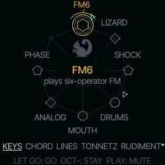
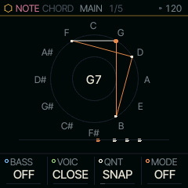

# SQRL-1

SQRL-1 is firmware for the M-VAVE FM-1. It is a fork of [Felucca](https://github.com/hugelton/Felucca), the open
firmware for the FM-1 by Leo Kuroshita (Hügelton Instruments), and keeps everything under Felucca's screens: its
engines, voices, sequencer, effects, storage and installer. In place of Felucca's UI it has a shell of its own,
built around pairs.

You always play a pair: a SOUND, which makes the tone, and a NOTE engine, which decides what notes to play. Both
are called nuts. Hold HOME and the octave from C4 to C5 becomes the wheel: a white key picks the SOUND, a black key
the NOTE engine. Hold HOME and tap GLO instead to choose the pair with the knobs.




- **SOUND nuts:** eight, one on each white key: FM6, LIZARD (draw the wave), SHOCK, DRUMS (the drum kits), MOUTH
  (SAM-style speech), ANALOG, PHASE and PHYS. Felucca's other engines and databurn's stay in the source and come
  back in a custom build ([On the sidelines](docs/sidelines.md)).
- **NOTE nuts:** KEYS, CHORD (Orchid-style chords with voicings, strum and just tuning), RUDIMENT (eight lanes of
  steps, each its own length: a beat under DRUMS, notes under any other SOUND), LINES (a second set of lanes, for a
  line over RUDIMENT's beat), ALIVE (a cellular automaton), TONNETZ
  (chords that walk the Tonnetz), ENIGMA (loops a phrase and mutates it), S+H (sample and hold), CANON (a round of
  the notes you play), ACID (a 303-style line) and HARP (chord buttons and a strum plate).
- **Shared effects:** a three-head tape echo with wow, saturation and reverse, a reverb with pre-delay, a chorus with
  ensemble and dimension modes, and a rotating-speaker insert.

## The manual

[docs/](docs/README.md) is the manual: every nut, page and knob, with the FM-1's own screens. Its tables, ranges and
screens are generated from the firmware, and the test suite fails if they differ from the build, so they match the
firmware they ship with. Start with [Getting started](docs/start.md).

## Install

The installer is a web page, [databurn.org/sqrl/install](https://databurn.org/sqrl/install/), for Chrome or Edge
over USB. Each release also attaches its package to the GitHub release page. Installing is at your own risk.

- **Back up first if you have music on the FM-1.** Felucca's editor makes a complete backup; SQRL-1 reads it.
- **To go back,** download official V15, `FM-1.fwsc`, from [M-VAVE's download page](https://www.m-vave.com/download)
  (FM-1, "PC Firmware") and use the installer's **Return to official V15**. It checks that the file is V15, saves a
  complete backup of your SQRL-1 music and sounds to the computer, then installs it. This has been tried on a device.
  M-VAVE's own updater, M-UPGRADE, does not see an FM-1 running SQRL-1; once the FM-1 is back on V15, M-UPGRADE
  works as it does on stock firmware.
- **If an install is interrupted,** press Install again: it is built to resume. An FM-1 that no longer starts at
  all can be recovered with [FM-1-transporter](https://github.com/kurogedelic/FM-1-transporter) (see Known
  issues).

## Known issues

- **A shared USB ID.** SQRL-1 shows up as 1209:0001 (its updater as 1209:0002), pid.codes' test IDs, which Felucca
  and other test devices use too. A computer can't tell them apart by ID, and Windows keeps the name it first saw
  for an ID, so a computer that has run Felucca may still list SQRL-1 as "Felucca". SQRL-1's own ID is planned for
  v1.0.1.
- **Untested recovery.** Resuming an interrupted install and recovering with FM-1-transporter have not been tried
  on a device.
- **One program at a time on the USB port.** On Windows, M-UPGRADE can't open the FM-1 while Chrome or Edge holds
  it. Close the browser before you run M-UPGRADE.
- **Heavy patches can glitch.** Eight BOWED METAL voices across three parts, with the inserts and SHAPE on,
  are estimated to exceed the CPU budget. The FM-1 then drops voices to recover, and you may hear a click or a stutter first.
- **Official V15's own presets.** Whether the presets and patterns saved under official V15 survive an install of
  SQRL-1 has not been checked, and the installer can't back them up.
- **M-VAVE's FM1 Open.** M-VAVE's second official firmware keeps its projects and samples in the flash SQRL-1's code
  uses, so the installer refuses an FM-1 running it. Back up your projects and samples and return to official V15
  with M-VAVE's workbench, then install SQRL-1. To go from SQRL-1 to FM1 Open, return to official V15 first;
  M-VAVE's direct route over SQRL-1 has not been tested.
- **USB audio on macOS** has not been tested.
- **TALK** is not in this release (see the [changelog](CHANGELOG.md)).

## Bugs

Open an issue at [github.com/hed0rah/sqrl-1/issues](https://github.com/hed0rah/sqrl-1/issues) with the version
(tap GLO four times for ABOUT) and, for an install problem, the installer's log. [CONTRIBUTING.md](CONTRIBUTING.md)
says what else helps.

## Build

```
FELUCCA_SHELL=1 ./build.sh
```

[BUILDING.md](BUILDING.md) lists what the build needs, and [CONTRIBUTING.md](CONTRIBUTING.md) explains how the
source is laid out and how the tests work. The manual's [Making a nut](docs/making-a-nut.md) walks through adding an
engine.

## Licence

SQRL-1 is a modified version of Felucca 1.5.6: hed0rah forked it on 10.12.2026 and has changed it since. Felucca is
by Leo Kuroshita (Hügelton Instruments).

SQRL-1 is free software under Felucca's licence, GPL-3.0-only ([LICENSE](LICENSE)). Some parts keep their own
licences: databurn's engines are MIT, FM6's operator core is msfa (Apache-2.0), PHYS ports DaisySP and Rings (MIT),
and the art (the squirrel, the marks and Nibs) is CC-BY-SA-4.0.
[LICENSING.md](LICENSING.md) and `LICENSES/` have the details, and the manual's [credits](docs/credits.md) list
every file whose licence or author differs.

M-VAVE and FM-1 are trademarks of their respective owners. SQRL-1 is not affiliated with or endorsed by M-VAVE or
Hügelton Instruments.
