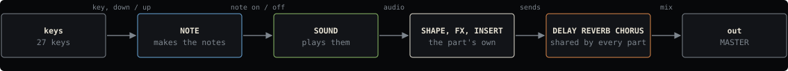

<!-- generated by tools/gen_docs.py from docs/src/index.md and the firmware: edit the source, not this file -->
# SQRL-1

SQRL-1 is firmware for the M-VAVE FM-1, built on [Felucca](https://github.com/hugelton/Felucca). It replaces the
FM-1's screens with a shell of its own, and every instrument in it is a nut: a SOUND that makes the
tone, or a NOTE engine that decides which notes to play. You play a pair of them, one of each.

The tables, ranges, factory sounds and screens on every page are generated from the firmware, so they match the
build they ship with.

## SOUND nuts

A SOUND is a synthesis engine with its own pages and factory sounds. SQRL-1 has eight, one on each of the wheel's
white keys. The other engines Felucca and databurn wrote are [on the sidelines](sidelines.md): in the source, each
back with a build flag, and a sound saved on one of them plays on its nearest of the eight.

| | Nut | What it does | Reach it |
| --- | --- | --- | --- |
|  | [FM6](sound/fm6.md) | plays six-operator FM | white key C4 in the wheel |
|  | [LIZARD](sound/lizard.md) | draw the wave | white key D4 in the wheel |
|  | [DRUMS](sound/drums.md) | plays drum kits | white key F4 in the wheel |
|  | [SHOCK](sound/shock.md) | steepens a sine into brass | white key E4 in the wheel |
|  | [ANALOG](sound/analog.md) | filters two oscillators | white key A4 in the wheel |
|  | [PHASE](sound/phase.md) | bends a cosine, CZ style | white key B4 in the wheel |
|  | [PHYS](sound/phys.md) | rings bars and strings | white key C5 in the wheel |
|  | [MOUTH](sound/mouth.md) | sings words, SAM style | white key G4 in the wheel |

## NOTE nuts

A NOTE engine sits between the keys and the SOUND. KEYS passes your playing through as it is; the others turn a
key into a chord, a strum or a walk around the Tonnetz, answer it in canon, or grow a melody by themselves.

| | Nut | What it does | Reach it |
| --- | --- | --- | --- |
|  | [KEYS](note/keys.md) | you play | black key C#4 in the wheel |
|  | [CHORD](note/chord.md) | plays a chord per key | black key D#4 in the wheel |
|  | [ALIVE](note/alive.md) | grows notes from an automaton | the slot picker |
|  | [TONNETZ](note/tonnetz.md) | walks a triad round the Tonnetz | black key G#4 in the wheel |
|  | [ENIGMA](note/enigma.md) | loops a phrase and mutates it | the slot picker |
|  | [HARP](note/harp.md) | strums a chord on the keys | the slot picker |
|  | [RUDIMENT](note/rudiment.md) | builds a beat on the keys | black key A#4 in the wheel |
|  | [LINES](note/lines.md) | plays a line in lanes | black key F#4 in the wheel |
|  | [S+H](note/s-h.md) | samples a source into the scale | the slot picker |
|  | [CANON](note/canon.md) | answers what you play | the slot picker |
|  | [ACID](note/acid.md) | plays a 303 line | the slot picker |

## Reading this manual

Install it with [Getting started](start.md), then read [The shell](shell.md) and
[The wheel](wheel.md): the same few gestures work in every nut. Each nut's page starts with what you play (its keys
and the four knobs on its MAIN page), then shows its deeper pages as the FM-1's screen draws them.

Knob tables give each knob's label, its range and the value it starts at when you first open the nut. Knobs are
numbered left to right, and the coloured dot matches the dot on the screen.

## The rest of the manual

The shared pages apply to every SOUND. The last pages cover connecting the FM-1 and building SQRL-1 yourself.

- [Shared pages](pages.md): VOICE, GLIDE, SHAPE, ENV and LFO
- [Effects](effects.md): the inserts, delay, reverb and chorus
- [Sequencing](sequencing.md): the arpeggiator, the pattern, recording and the tempo
- [Connections](connections.md): USB, MIDI, clock, USB audio, the installer, the editor and backups
- [Building it yourself](build.md) and [Making a nut](making-a-nut.md)
- [Credits](credits.md): who wrote what, and under which licence
