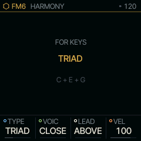

<!--
every number here is from docs/src or the v1.0.0 build; recheck them when the firmware moves.
-->

## Functional description

SQRL-1 replaces the FM-1's screens with a shell of its own. Every instrument in it is a *nut*: a SOUND that makes
the tone, or a NOTE engine that decides which notes to play. You always play a **pair**, one of each, and the same
few gestures work in every pair.

Between the keys and the speaker a note passes through the NOTE engine, the part's arpeggiator and sequencer, the
SOUND's voices, the part's own effects, and the buses every part shares.

:::diagram Signal Path of One Part
node keys "KEYS / MIDI IN" 0 0 round
node ne "NOTE ENGINE" 1 0
node arp "ARP" 2 0
node seq "SEQ / PATTERN" 2 1 drum
node snd "SOUND VOICES" 3 0
node shp "SHAPE + INSERT" 4 0
node bus "DELAY REVERB CHORUS" 4 1
node out "MASTER: DAC, USB AUDIO" 5 0 round
edge keys ne
edge ne arp "NOTES"
edge arp seq "REC" both
edge arp snd
edge seq snd "PLAYBACK"
edge snd shp
edge shp bus "SENDS"
edge shp out
edge bus out
fence "PART (ONE OF FOUR)" ne arp seq snd shp
:::

A part is one of the FM-1's four sound channels, each with its own sound, effects and pattern. The shell maps three
tracks onto them, so that what you leave keeps playing:

:::table Tracks and Parts
| Track | Part | Holds | NOTE engines |
|---|---|---|---|
| PLAY | 1 and 2, in turn | what you play from the keys, with its take | KEYS, CHORD, HARP |
| LINE | 3 | the engine that plays by itself, one at a time | LINES, ALIVE, TONNETZ, ENIGMA, S+H, CANON, ACID |
| BEAT | 4 | the beat machine | RUDIMENT |
:::

PLAY alternates between parts 1 and 2 as you change pairs, so the pair you left rings out, and two takes can loop
together. BEAT and LINE run whenever the transport runs, once they hold something.

## The wheel

The wheel is the octave from C4 to C5. The white keys hold the eight SOUNDs and are fixed; the black keys hold NOTE
engines and are yours to set. Hold HOME, press a white key and a black key in either order, and let go.

::::row
{gray=1}
|||
:::table Default Wheel
| Key | Nut | Key | Nut |
|---|---|---|---|
| C4 | FM6 | C#4 | KEYS |
| D4 | LIZARD | D#4 | CHORD |
| E4 | SHOCK | F#4 | LINES |
| F4 | DRUMS | G#4 | TONNETZ |
| G4 | MOUTH | A#4 | RUDIMENT |
| A4 | ANALOG | | |
| B4 | PHASE | | |
| C5 | PHYS | | |
:::
::::

With the wheel open, hold GLO and press a black key for the **slot picker**: every NOTE engine is listed, SELECT
chooses, and letting go of GLO puts it on the key. Each engine appears once. The layout is kept over power-off.

:::matrix What Each NOTE Engine Does
cols "PLAYS ITSELF" "TAKES ARP" "RECORDED" "HARMONY" "WHITE KEYS = STEPS"
row "KEYS" no yes yes yes part
row "CHORD" no yes yes no part
row "HARP" no no yes no no
row "LINES" yes no yes yes yes
row "ALIVE" yes yes no yes no
row "TONNETZ" yes no no no no
row "ENIGMA" yes no no yes no
row "S+H" yes no no yes no
row "CANON" yes no no yes no
row "ACID" yes no yes no part
row "RUDIMENT" yes no yes part yes
:::

<!-- part on WHITE KEYS = STEPS: KEYS and CHORD on the SEQ page or with SEQ held; ACID while stopped.
     HARMONY needs a POLY part, so ACID (one note at a time) and RUDIMENT on DRUMS take none. -->

## Theory of operation

### Buttons: tap, hold and long

Every button follows one timing rule, so a gesture means the same thing in every nut.

:::table Button Timing
| Gesture | Threshold | Effect |
|---|---|---|
| tap | released before 300 ms | acts on release |
| hold | 300 ms, or at once when another control is touched | a modifier; nothing on release |
| long | 1.2 s, a ring fills on screen | kept for actions that destroy something |
| PLAY, REC, OCT-, OCT+ | on press | the transport and the octave never lag |
:::

### Steps, polymeter and swing

Every part has its own LEN (1 to 64 steps), and on RUDIMENT and LINES each lane may have its own LEN too. Two loops
of lengths $L_1$ and $L_2$ line up again after their least common multiple:

$$ T = \mathrm{lcm}(L_1, L_2) $$

:::symbols
T | steps until both loops start together again | steps
L_1, L_2 | the two loop lengths | steps
:::

LINES at 24 over RUDIMENT at 16 lines up every 48 steps. A five step hat against a sixteen step kick lines up every
80 steps, five bars of the kick:

:::signals Five Step Hat over a Sixteen Step Kick, First Bar
signal "STEP" nnnnnnnnnnnnnnnn
signal "KICK 16" 1000100010001000
signal "HAT 5" 1000010000100001
:::

GROOVE on SYSTEM 2 shapes the swing; its depth is SWG. At SWG 100, SWING puts every other sixteenth at 70 % of the
eighth and SHUFFLE on the triplet (two thirds); PUSH moves it early; LAID adds beats 2 and 4 late; HUMAN moves each
step up to 8 ms and its velocity up to 10 %, the same in every bar, so a loop repeats exactly.

### The audio interrupt

The audio interrupt fills a half buffer of 128 frames in blocks of 32 samples: events first (keys, sequencer, the
shell's block), then each part's voices, the buses and the master. A NOTE engine runs once a block.

:::equations
t_{half} = 128 / 44100\ \mathrm{Hz} = 2.90\ \mathrm{ms}
t_{block} = 32 / 44100\ \mathrm{Hz} = 0.73\ \mathrm{ms}
:::

A half buffer over 85 % twice running, or over 95 % once, sheds a voice: the oldest released voice first, then the
oldest extra UNISON voice, then the oldest held note of a POLY part other than its lowest. SYSTEM's DSP meter turns
red at a 90 % peak or after any late block. There is no heap and no allocation in the interrupt.

## Performance and design data

:::budget Memory at v1.0.0
bar "RAM" 52164 73728 B
bar "POOL" 357272 368640 B
:::

:::table Gates the Build Enforces
| Resource | Used | Capacity | Gate | Spare |
|---|---|---|---|---|
| RAM | 52164 B | 73728 B | at least 4096 B free | 21564 B |
| .pool section | 357272 B | 368640 B | at least 8192 B free | 11368 B |
| parameters (`P_COUNT`) | 127 | 127 | motion stores the id in 7 bits | 0 |
| shell parameters (`SP_*`) | 160 to 229 | 254 | page ids are a byte, 0xFF is none | 26 |
| locks and knob moves | | 128 a part | LOCKS FULL | |
| notes a step | | 6 | PROJECT TOO FULL | |
| pattern length | | 64 steps | DOUBLE stops at 64 | |
| user sound slots | | 32, every SOUND | SAVE says so | |
| project slots | | 4, A to D | | |
:::

The 10.27 trim paid for the new features: the USB console's buffer went from 2048 to 512 bytes, the shell keeps a
snapshot only for the SOUNDs on the wheel, ALIVE's rows and the MIDI note map were packed, and Felucca's song chain
went to one source, since the PROJECTS queue plays a song.

:::bits A Motion Record's Parameter Byte
width 8
field "LOCK" 1
field "PARAMETER ID (0-126)" 7
:::

A lock and a recorded knob move share one record per step and parameter, which is why `P_COUNT` cannot pass 127.

## Recording

:::diagram Transport and Take States
node stop "STOPPED" 0 0 round
node cnt "COUNT-IN" 1 0 round
node first "FIRST TAKE" 2 0 round
node loop "LOOPING" 2 1 round
node dub "OVERDUB" 3 1 round
edge stop cnt "REC + PLAY"
edge cnt first "ONE BAR"
edge first loop "TAP REC"
edge loop dub "TAP REC"
edge dub loop "TAP REC" bend=0.4
edge loop stop "PLAY"
:::

The first take on an empty pattern sets the loop: the bars it ran, rounded to the nearest (2.4 make 2, 2.6 make 3),
up to 64 steps, never short of a note you played. Armed while the transport already runs, the loop starts at the bar
of your first note. Later takes overdub at that length: a note adds to what a step holds and never erases it.

:::table REC MODE (hold REC, turn SELECT)
| Mode | A pass |
|---|---|
| ADD | adds its notes to what each step holds (the default) |
| ADD + KNOBS | the same, and knob moves record |
| REPLACE | the first note a pass puts in a step replaces an earlier pass's |
| REPLACE + KNOBS | the same, with knob moves |
:::

Holding REC fills two rings. Released after the first: UNDO TAKE (or UNDO BEAT, UNDO SOUND, UNDO NEW, as the ring
names it). Held through the second: the pattern and its knob moves are cleared. One level of undo, and a clear can
be undone the same way.

### A held step

Where the white keys are steps, hold one to edit it. The knob cards become the step's own:

:::table Step Edit (hold a white key)
| Control | Sets |
|---|---|
| C#5 / D#5 / F#5 | ACCENT / SLIDE into the next / TIE from the one before |
| black key F#3-A#4 | lanes: that lane's hit; KEYS and ACID: the note, that scale degree |
| OCT+ / OCT- / SELECT | the note an octave up or down / a semitone |
| KNOB 1 CHNC | 0-100 %, then 1:2 to 4:4, FILL, !FILL |
| KNOB 2 RATCH | x1 to x4 in the step |
| KNOB 3 NUDGE | -8 to +7 sixteenths of a step |
| KNOB 4 VEL | the step's velocity |
| any SOUND knob | a lock on this step only (card starred, `*CUT`) |
:::

## SCALE, HARMONY and MOVE

SCL opens one scale that every nut shares. QNT decides what a part does with it:

:::table QNT Settings
| QNT | Keys | Pattern notes |
|---|---|---|
| OFF | as played | as stored |
| SNAP | down to the scale | as stored |
| WHITE | the scale on the white keys from ROOT at C4; black keys silent | as stored |
| SEQ | as SNAP | mapped onto the scale |
| SEQ+T | as SNAP | as SEQ, following TRN |
| NEAR | to the nearest; a tie goes toward the last note | to the nearest |
| DROP | silent if off the scale | silent if off the scale; steps kept |
| CHORD | to the nearest tone of the chord PLAY sounds | the same; generators pick chord tones |
:::

**Drawing a scale.** On SCALE the keys are silent and show the scale, ROOT lit. Press several together and on
release they are the scale, the lowest the ROOT (SCALE reads USER). A single tap toggles one note; a named scale is
copied first, so MIN with its sixth tapped becomes Dorian. USER is saved with the project.

**HARMONY**, the second tap of SCL, adds notes from the scale to every note the NOTE engine in front plays. Each
NOTE engine keeps its own.

::::row
{gray=1}
|||
:::table HARMONY Knobs
| Knob | Values |
|---|---|
| TYPE | OFF 3RD 5TH TRIAD 7TH SUS2 SUS4 6TH ADD9 OCT |
| VOIC | CLOSE, OPEN, DROP2, WIDE |
| LEAD | ABOVE (you play the bottom), BELOW (the top) |
| VEL | the harmony's level against the note |
:::
::::

The harmony's voices end with the note that started them, come out of the part's eight voices, and are never
recorded: a take holds what you played and plays it harmonized. It needs VOICE mode POLY; CHORD, TONNETZ, HARP and
DRUMS take none, and the page says why.

**MOVE**, SELECT on from SCALE, moves the scale by itself on the bar line: every 1, 2, 4 or 8 bars, by MODE (the next
darker mode on the same root), 5TH, ALT (between yours and another) or RAND, home again after BACK moves.

## Storage

:::table What Is Kept over Power-off
| What | Written by | When |
|---|---|---|
| your sounds, 32 slots | SAVE, OCT+ | at once, stopped |
| a project, slots A to D | GLO x3, OCT+ OCT+ | at once; while playing, at the stop |
| the music (autosave) | itself | 10 s quiet and stopped, at most once a minute |
| wheel layout, last pair, engines' four knobs | itself | once settled and quiet |
| MOUTH phrases U1 to U8 | SAVE on SPELL | at once |
:::

The autosave is written only once something has changed, the transport is stopped and the FM-1 has been quiet for
ten seconds, at most once a minute, so the flash wears only when there is something new. After a crash it is not
restored; it is kept, and nothing is written over it until you save to or load from PROJECTS.

A project holds every part's sound and pattern, the motion, the tempo, GROOVE, ROUT, the drawn scale, each NOTE
engine's HARMONY and the pairs on the tracks, and beside it the takes parked with pairs no part holds. A save asked
for while playing waits for the stop (SAVES TO C AT STOP).

:::timeline Autosave After a Stop
axis "seconds after stop" 0 75 ticks=15
bar "QUIET" 0 10 open
milestone "QUIET" 10 "WRITE"
bar "GAP" 10 70 hatch
milestone "GAP" 70 "NEXT ALLOWED"
:::

## Connections

:::table USB Functions (device name SQRL-1, class compliant)
| Function | Carries |
|---|---|
| USB MIDI | notes and CCs in, the keys out, clock in; the installer and editor |
| USB audio | the output, 16-bit stereo at 44.1 or 48 kHz (resampled from 44.1) |
| Serial console | `status`, `stack`, `crash`, `inp`, `params`, `dbg`, `memr`, `flr` |
:::

The TRS jack is MIDI in at 31250 baud: notes, CCs, bend, aftertouch, Program Change and clock, on the same channels
as USB. SysEx on it is ignored and SQRL-1 sends nothing on it. ROUT on SYSTEM 2 picks the channels: SEL sends every
channel to the pair in front; CH1-4 (or a later block of four) gives each part its channel.

:::table Fixed Controllers
| CC | Sets | CC | Sets |
|---|---|---|---|
| 1 | mod wheel | 72 | REL |
| 5 | GLD | 73 | ATK |
| 7 | LVL | 74 | cutoff or brightness |
| 10 | PAN | 75 | DEC |
| 11 | expression | 91 / 93 / 94 | REV / CHO / DLY send |
| 64 | sustain | 120 / 123 | all sound off / all notes off |
| 71 | resonance | 121 | reset controllers |
:::

## Procedures

:::checklist Install SQRL-1 | Owner, Chrome or Edge
1  connect the FM-1 straight to the computer
     a USB data cable, no hub
2  close every DAW and app using the FM-1's MIDI port
3  open the installer, allow MIDI with SysEx
4  read the ready line
     the build named is the one meant
5  press Install
6  leave the cable alone until the page says done
     an interrupted install resumes on Install
:::

:::checklist First Loop | Player
HOME + C4 + D#4 ...... FM6 CHORD
REC + PLAY ........... COUNT IN
CHORDS FROM D4 ....... PLAY
REC .................. TAKE CLOSED
REC .................. OVERDUB
PLAY ................. STOP
GLO X3, KNOB 1 ....... SLOT
OCT+, OCT+ ........... SAVED
:::

:::checklist No Sound | Player
1  MASTER up
2  generators: PLAY, or hold a key
3  HOME glowing: a part is muted
     HOME + its pair + PLAY brings it back
4  PLAY stops after half a second
     CLK is USB or TRS with no clock: set INT
:::

## Cautions

:::warning
A stock Felucca backup shows SQRL-1's project slots as empty and saves them empty, so restoring it erases them. Back
up with SQRL-1's own editor.
:::

:::caution
An FM-1 running M-VAVE's FM1 Open keeps its projects where SQRL-1's code goes; the installer stops. Back up and
return to official V15 first.
:::

:::caution
M-UPGRADE does not see an FM-1 running SQRL-1. Use the installer's Return to official V15 first; it checks the file
and backs up your music before writing.
:::

:::note
A change in the last minute before power-off may not be in the autosave. Save to PROJECTS what you mean to keep.
:::
