<!-- generated by tools/gen_docs.py from docs/src/effects.md and the firmware: edit the source, not this file -->
# Effects

Each part has its own distortion and one INSERT effect, and sends to three effects that every part shares: a tape
delay, a reverb and a chorus. The FX button walks all of them. The shared pages show ALL in the header, because
turning a knob there changes the effect under every part, not only the one in front.

A part's signal runs: engine, DIST, INSERT, level and pan, then the sends into the shared delay, reverb and chorus,
then the master.

## The part's own

### FX

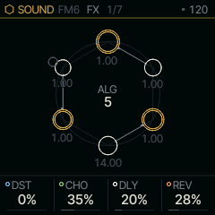

| Knob | Label | Range | Starts at |
| --- | --- | --- | --- |
| 1 | `DST` | 0% .. 100% | 0% |
| 2 | `CHO` | 0% .. 100% | 35% |
| 3 | `DLY` | 0% .. 100% | 20% |
| 4 | `REV` | 0% .. 100% | 28% |

DST drives the part into Felucca's distortion. CHO, DLY and REV are the part's sends: how much of it goes into the
shared chorus, delay and reverb. At 0 none of the part goes into that effect, whatever the shared page says.

### INSERT

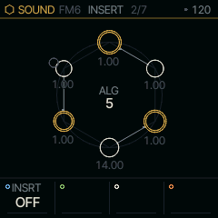

| Knob | Label | Range | Starts at |
| --- | --- | --- | --- |
| 1 | `INSRT` | 14 values: OFF SOFT HARD FOLD .. COMB | OFF |

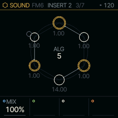

| Knob | Label | Range | Starts at |
| --- | --- | --- | --- |
| 1 | `MIX` | 0% .. 100% | 100% |

The INSERT is one effect in the part's own line, after DIST. INSRT picks its type, and the three knobs after it
take that type's names: DRIVE TONE LEVEL for the drives, CUT RES MORPH for FILTER, and so on. With INSRT on OFF the
three are blank until you pick one. MIX on INSERT 2 blends the dry part with the effect. With INSRT on OFF or MIX at 0 the
part passes through untouched. Changing the type fades the old effect out and the new one in, so you can switch
while a note rings.

### SOFT

| Knob | Label | Range | Starts at |
| --- | --- | --- | --- |
| 1 | `INSRT` | 14 values: OFF SOFT HARD FOLD .. COMB | SOFT |
| 2 | `DRIVE` | 0% .. 100% | 50% |
| 3 | `TONE` | 30Hz .. 16.0kHz | 3.4kHz |
| 4 | `LEVEL` | OFF .. 7.5dB | -8.0dB |

SOFT is a smooth saturation (a tanh curve). DRIVE pushes the part into it, TONE rolls off the top and LEVEL sets
the output.

### HARD

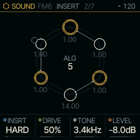

| Knob | Label | Range | Starts at |
| --- | --- | --- | --- |
| 1 | `INSRT` | 14 values: OFF SOFT HARD FOLD .. COMB | HARD |
| 2 | `DRIVE` | 0% .. 100% | 50% |
| 3 | `TONE` | 30Hz .. 16.0kHz | 3.4kHz |
| 4 | `LEVEL` | OFF .. 7.5dB | -8.0dB |

HARD clips flat at a voice's full level. It is brighter and more abrupt than SOFT and has the same three knobs.

### FOLD

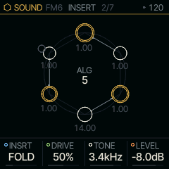

| Knob | Label | Range | Starts at |
| --- | --- | --- | --- |
| 1 | `INSRT` | 14 values: OFF SOFT HARD FOLD .. COMB | FOLD |
| 2 | `DRIVE` | 0% .. 100% | 50% |
| 3 | `TONE` | 30Hz .. 16.0kHz | 3.4kHz |
| 4 | `LEVEL` | OFF .. 7.5dB | -8.0dB |

FOLD reflects the wave back each time it reaches the ceiling, so more DRIVE adds harmonics rather than loudness.

### FUZZ

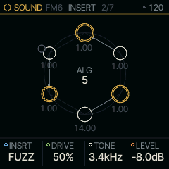

| Knob | Label | Range | Starts at |
| --- | --- | --- | --- |
| 1 | `INSRT` | 14 values: OFF SOFT HARD FOLD .. COMB | FUZZ |
| 2 | `DRIVE` | 0% .. 100% | 50% |
| 3 | `TONE` | 30Hz .. 16.0kHz | 3.4kHz |
| 4 | `LEVEL` | OFF .. 7.5dB | -8.0dB |

FUZZ has a hard top and a soft, halved bottom. The two halves clip differently, which gives the lopsided buzz of
a fuzz pedal.

### CRUSH

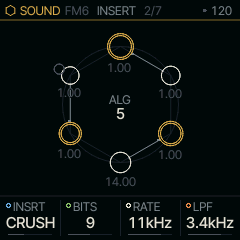

| Knob | Label | Range | Starts at |
| --- | --- | --- | --- |
| 1 | `INSRT` | 14 values: OFF SOFT HARD FOLD .. COMB | CRUSH |
| 2 | `BITS` | 1 .. 16 | 9 |
| 3 | `RATE` | 689Hz .. 44kHz | 11kHz |
| 4 | `LPF` | 30Hz .. 16.0kHz | 3.4kHz |

CRUSH is a bit crusher. BITS cuts the resolution, RATE holds each sample for longer to alias like an early sampler,
and LPF smooths what comes out.

### PHASR

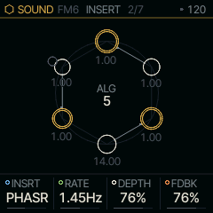

| Knob | Label | Range | Starts at |
| --- | --- | --- | --- |
| 1 | `INSRT` | 14 values: OFF SOFT HARD FOLD .. COMB | PHASR |
| 2 | `RATE` | .05Hz .. 40.0Hz | 1.45Hz |
| 3 | `DEPTH` | 0% .. 100% | 76% |
| 4 | `FDBK` | 0% .. 100% | 76% |

PHASR is a four-stage phaser. RATE sets the sweep's speed, DEPTH how far it sweeps and FDBK how sharply the
notches ring.

### FLANG

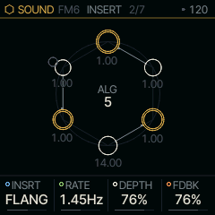

| Knob | Label | Range | Starts at |
| --- | --- | --- | --- |
| 1 | `INSRT` | 14 values: OFF SOFT HARD FOLD .. COMB | FLANG |
| 2 | `RATE` | .05Hz .. 40.0Hz | 1.45Hz |
| 3 | `DEPTH` | 0% .. 100% | 76% |
| 4 | `FDBK` | 0% .. 100% | 76% |

FLANG mixes a short swept delay with the dry sound. FDBK feeds it back on itself for the metallic, jet-like sweep.

### CHOR

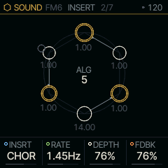

| Knob | Label | Range | Starts at |
| --- | --- | --- | --- |
| 1 | `INSRT` | 14 values: OFF SOFT HARD FOLD .. COMB | CHOR |
| 2 | `RATE` | .05Hz .. 40.0Hz | 1.45Hz |
| 3 | `DEPTH` | 0% .. 100% | 76% |
| 4 | `FDBK` | 0% .. 100% | 76% |

CHOR is a chorus on this part alone, with gentler feedback than FLANG. Use it when one part should shimmer and the
others should not; the shared CHORUS below is for everything at once.

### ROTOR

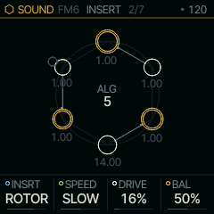

| Knob | Label | Range | Starts at |
| --- | --- | --- | --- |
| 1 | `INSRT` | 14 values: OFF SOFT HARD FOLD .. COMB | ROTOR |
| 2 | `SPEED` | STOP SLOW FAST | SLOW |
| 3 | `DRIVE` | 0% .. 100% | 16% |
| 4 | `BAL` | 0% .. 100% | 50% |

ROTOR is a rotating-speaker cabinet. A crossover splits the sound between a horn for the highs and a drum for the
lows, and each rotor spins at SPEED: STOP (the brake), SLOW (chorale) or FAST (tremolo). Each rotor speeds up and
slows down with its own inertia, the light horn settling in about a second and the heavy drum in a few, so a switch
from SLOW to FAST swirls up and the two drift apart on the way. DRIVE is the cabinet's preamp, a soft clip before
the crossover. BAL moves the balance from the drum to the horn. Put it on ANALOG or SHOCK for the cabinet a tonewheel
organ usually plays through.

### RESON

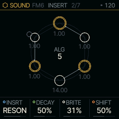

| Knob | Label | Range | Starts at |
| --- | --- | --- | --- |
| 1 | `INSRT` | 14 values: OFF SOFT HARD FOLD .. COMB | RESON |
| 2 | `DECAY` | 0% .. 100% | 50% |
| 3 | `BRITE` | 0% .. 100% | 31% |
| 4 | `SHIFT` | 0% .. 100% | 50% |

RESON is a bank of resonators tuned to the notes the part is playing, so noise, speech, plucks or drums sound as the
held chord. Each note rings at its fundamental, and BRITE brings in its octave and twelfth. DECAY sets how long they
ring, from 50 ms to 4 s. SHIFT moves the whole bank an octave down or up in semitones; the middle of the knob is the
chord as played. Bends and TUNE JUST follow, so a just chord rings just. With nothing held, the bank keeps the last
chord, so a pad's release still rings. Try it on MOUTH or a DRUM kit under CHORD.

### VOWEL

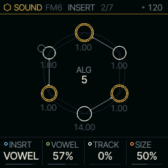

| Knob | Label | Range | Starts at |
| --- | --- | --- | --- |
| 1 | `INSRT` | 14 values: OFF SOFT HARD FOLD .. COMB | VOWEL |
| 2 | `VOWEL` | 0% .. 100% | 57% |
| 3 | `TRACK` | 0% .. 100% | 0% |
| 4 | `SIZE` | 0% .. 100% | 50% |

VOWEL puts the sound through a vowel, as a talk box does: three formant filters on MOUTH's vowels. The VOWEL
knob walks from IY through AA to UW (the plaster casts' I E A O U at 0, 36, 73, 91 and 127). TRACK lets the part's
own loudness open the mouth toward AA, so a swelling note says "ee-ah" (a wah that talks). SIZE scales the vocal
tract from a giant's to a child's.

### FILTR

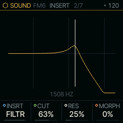

| Knob | Label | Range | Starts at |
| --- | --- | --- | --- |
| 1 | `INSRT` | 14 values: OFF SOFT HARD FOLD .. COMB | FILTR |
| 2 | `CUT` | 0% .. 100% | 63% |
| 3 | `RES` | 0% .. 100% | 25% |
| 4 | `MORPH` | 0% .. 100% | 0% |

FILTR is a state-variable filter. MORPH turns it from low-pass through band-pass and high-pass to a notch, and RES
raises the peak at CUT up to the edge of ringing on its own. INSERT 2 holds three more: DRV drives the sound into it,
KTRK makes CUT follow the note you play, and ENV lets the sound's own loudness move CUT up or down by up to three
octaves. The screen draws its response as it stands, CUT marked, so the curve moves while you play.

### COMB

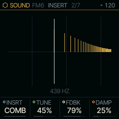

| Knob | Label | Range | Starts at |
| --- | --- | --- | --- |
| 1 | `INSRT` | 14 values: OFF SOFT HARD FOLD .. COMB | COMB |
| 2 | `TUNE` | 0% .. 100% | 45% |
| 3 | `FDBK` | 0% .. 100% | 79% |
| 4 | `DAMP` | 0% .. 100% | 25% |

COMB is a delay tuned to a pitch and fed back into itself. With FDBK above the middle it rings every harmonic of TUNE,
as a plucked string does; below the middle only the odd ones ring, which sounds hollow. DAMP darkens the ring as it
fades. Its lowest pitch is about F3 (172 Hz), or 86 Hz with FDBK below the middle. DRV, KTRK and ENV on INSERT 2 work
as FILTR's, on its pitch. The screen draws the harmonics that ring.

## Shared by every part

### DELAY

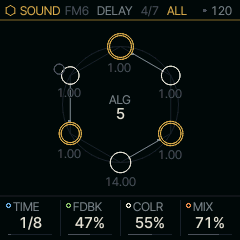

| Knob | Label | Range | Starts at |
| --- | --- | --- | --- |
| 1 | `TIME` | 13 values: 4BAR 2BAR 1/1 1/2 .. 1/32 | 1/8 |
| 2 | `FDBK` | 0% .. 94% | 47% |
| 3 | `COLR` | 0% .. 100% | 55% |
| 4 | `MIX` | 0% .. 100% | 71% |

DELAY is a tape echo with three playback heads on one loop. TIME is a tempo division, and it sets where the furthest
head sits, so the longest repeat always lands on the beat. FDBK feeds the repeats back, COLR darkens them on each
pass, and MIX sets the level of the echo.

Changing TIME changes the speed of the tape rather than moving the heads, so the repeats bend in pitch as they
settle.

### DELAY 2

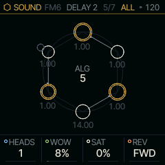

| Knob | Label | Range | Starts at |
| --- | --- | --- | --- |
| 1 | `HEADS` | 1 2 3 1+2 2+3 1+3 ALL | 1 |
| 2 | `WOW` | 0% .. 100% | 8% |
| 3 | `SAT` | 0% .. 100% | 0% |
| 4 | `REV` | FWD REV ALT | FWD |

HEADS picks which heads play. The heads playing are spaced evenly up to the furthest one, which sits at TIME, as on
a Space Echo, so each combination is a rhythm: all three under a 1/4 TIME give triplet eighths up to the quarter,
and 1+2 give eighths.

WOW wobbles the tape: a slow drift, a faster flutter and a little noise, as on a worn machine. SAT soft-clips
the loop and lowers its ceiling as it rises, so loud input squashes and high FDBK sings instead of running away.

REV plays the tape backwards in windows as long as TIME. REV reverses every repeat; ALT also feeds the reversed sound
back, so the repeats turn round each time they come back.

### REVERB

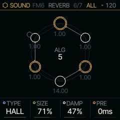

| Knob | Label | Range | Starts at |
| --- | --- | --- | --- |
| 1 | `TYPE` | ROOM SPRING HALL | HALL |
| 2 | `SIZE` | 0% .. 100% | 71% |
| 3 | `DAMP` | 0% .. 100% | 47% |
| 4 | `PRE` | 0ms .. 120ms | 0ms |

TYPE picks the space: ROOM, SPRING (one spring of a spring tank) or HALL (smooth, dense and stereo). SIZE sets the
length of the tail, DAMP how quickly its highs fade. PRE delays the reverb's start by up to the value shown in
milliseconds, so the dry note is heard before the room answers.

### CHORUS

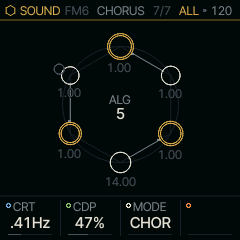

| Knob | Label | Range | Starts at |
| --- | --- | --- | --- |
| 1 | `CRT` | .05Hz .. 40.0Hz | .41Hz |
| 2 | `CDP` | 0% .. 100% | 47% |
| 3 | `MODE` | CHOR ENS DIM | CHOR |

CRT and CDP set the chorus's sweep rate and depth. MODE picks its character. CHOR is the plain chorus, one swept tap
and mono. ENS is the string machine's ensemble: three taps swept by a slow sine and a faster vibrato, spread left,
right and centre, which makes held chords shimmer. DIM is two shallow taps swept against each other, wide and still,
after the rack doublers.

## The FX layer

Hold **FX** and the keys play effects on the whole mix instead of notes; let go and they are notes again. A quick
tap of FX still walks the pages above. Each white key from F3 holds one effect while it is down, the black keys F#3,
G#3, A#3 and C#4 mute parts 1 to 4, and the screen shows which key holds what.

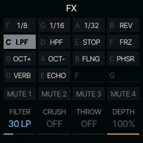

*FX held with C4 (LPF) down and FILTER turned towards LP.*

| Keys | Effects, by default |
| --- | --- |
| F3 G3 A3 B3 | REPEAT 1/8, 1/16, 1/32, REVERSE |
| C4 D4 E4 F4 | LPF, HPF, TAPE STOP, FREEZE |
| G4 A4 B4 C5 | OCT UP, OCT DN, FLANGER, PHASER |
| D5 E5 | REV THROW, ECHO THROW |

While FX is held, KNOB 1 to 4 are the layer's: FILTER (left a low-pass, right a high-pass), CRUSH, THROW (the mix
sent into the delay and reverb) and DEPTH, how much of the mix the playing effect takes. With OCT UP or OCT DN
playing, KNOB 4 is SHIMR, the octave's shimmer. They snap back when FX is let go, and nothing is recorded. SELECT,
PRESETS and ALGORITHM do nothing while FX is held, so nothing changes unseen.

Hold GLO, HOME or SEQ with FX and the keys are theirs, not the layer's.

## Where it comes from

DIST, the INSERT types up to CHOR, the reverbs, the send layout and the FX layer's effects are Felucca's. The tape
echo, the pre-delay, the chorus modes, ROTOR, RESON and VOWEL are databurn's (MIT): `firmware/src/tapedly.c`,
`ensemble.c`, `rotary.c`, `resonator.c` and `vowel.c`.
