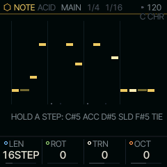
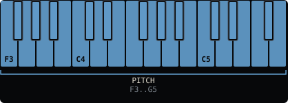
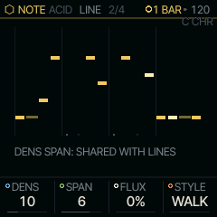

<!-- generated by tools/gen_docs.py from docs/src/note/acid.md and the firmware: edit the source, not this file -->
# ACID

ACID is a 303 line: one note a step, each with its own octave, and an ACCENT, a SLIDE into the next note or a TIE
that holds the one before. It plays on part 3, LINE, so you can make a line, leave it playing and go to RUDIMENT.

 **NOTE nut:** plays a 303 line. **Reach it:** the slot picker. **ALGORITHM turns:** `LINE`.

## Writing a line

Stopped, arm REC: the keys become a 303's pitch mode. Each key you press writes the next step's note and moves on,
from step 1, and you hear it. OCT+ and OCT- shift the keyboard for a high or a low note, SEQ puts a rest in the
step, and SEQ with a key still down puts a TIE there, so the note before holds on. Tap REC again to finish. The step
the next key writes breathes on the white keys.

Stopped and not armed, the white keys are the line's steps. Tap one to turn its step on or off (a new step takes
the note you entered last). Hold one to edit that step:

| While a step is held | It |
| --- | --- |
| C#5 | turns its ACCENT on or off |
| D#5 | turns its SLIDE into the next note on or off |
| F#5 | turns its TIE on or off |
| a black key F#3-A#4 | sets its note to that degree of the scale, 1 to 8 |
| OCT+ / OCT- | moves it an octave |
| SELECT | moves it a semitone, off the scale too |

Each note you set this way is heard. The keys of the held step's marks light while it is held. Past 16 steps, the
two black keys past C5 page the white keys with nothing held ([Step pages](../sequencing.md#step-pages)).

## Playing it

Press PLAY. A key pressed while it plays transposes the whole line from ROOT, as a 303's transpose does: C4 (with
ROOT C) puts it back. Hold SEQ while it plays to edit the steps again.

MAIN holds LEN, the line's length (the SEQ page's), ROT, which turns the whole line round a step at a time, notes and
marks together, TRN, which moves it along the scale by degrees, and OCT, which moves it by octaves. TRN, OCT and the
keys' transposition change what plays, never the notes you wrote. A project keeps the line with its ROT, TRN, OCT
and the LINE it was drawn from.

ALGORITHM writes a line for you, LINE 1 to 99, with the same writer as LINES: on the LINE page DENS sets how many
steps play and SPAN how many degrees the line uses. DENS and SPAN are shared with LINES. The first edit you make by
hand keeps the line as it is (the toast says KEPT), so DENS and SPAN never write over your edits. REC held to its
first ring undoes a line written over yours.

FLUX, on the LINE page, moves the line as it plays: each step, with chance FLUX, its note moves a degree or two
along the scale or an octave, or goes back to the note you wrote, or its ACCENT or SLIDE flips (one change in eight
each), and it stays that way pass after pass. Turn FLUX
to 0 to keep the line as it plays now; PLAY from stop starts from the line as written. The steps you wrote never
change. With QNT CHORD on SCALE, the line bends to the nearest note of the chord PLAY sounds, and TRN moves it
along the chord.

ACID on ANALOG, the first time, plays ANALOG's ACID sound with VCE on LEGATO, so a SLIDE glides into the next note
without a new attack; GLIDE on the GLIDE page sets how long it takes.

ACID is not on the default wheel: pick it on the PAIR page (hold HOME, tap GLO, KNOB 2) or give it a black key with
the slot picker ([The wheel](../wheel.md)). It plays on part 3, which it shares with LINES, ALIVE, TONNETZ, ENIGMA,
S+H and CANON.

## MAIN

| Knob | Label | Range | Starts at |
| --- | --- | --- | --- |
| 1 | `LEN` | 1STEP .. 64STEP | 16STEP |
| 2 | `ROT` | 0 .. 63 | 0 |
| 3 | `TRN` | -7 .. 7 | 0 |
| 4 | `OCT` | -2 .. 2 | 0 |

## Pages

### LINE

| Knob | Label | Range | Starts at |
| --- | --- | --- | --- |
| 1 | `DENS` | 1 .. 32 | 10 |
| 2 | `SPAN` | 1 .. 8 | 6 |
| 3 | `FLUX` | 0% .. 100% | 0% |
| 4 | `STYLE` | WALK OCTAVE PEDAL ARP CALL | WALK |

## Where it comes from

The steps follow the Roland TB-303's: a pitch, an accent and a slide each, written in pitch mode. The line writer is
LINES' own, after the TB-3PO idea in Hemisphere ([LINES](lines.md)). All of it is written fresh for SQRL-1
(`firmware/src/shell.c`, databurn, MIT).
