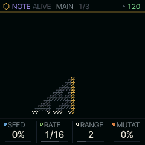
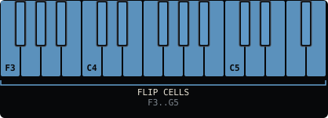

<!-- generated by tools/gen_docs.py from docs/src/note/alive.md and the firmware: edit the source, not this file -->
# ALIVE

ALIVE grows a melody from a one-dimensional cellular automaton, a row of cells that computes its next row from a
rule. The screen draws the rows as they pile up, and the cells in the middle of each new row decide whether a note
plays and which one.

 **NOTE nut:** grows notes from an automaton. **Reach it:** the slot picker. **ALGORITHM turns:** `RULE`.

## Playing it

Press PLAY and ALIVE grows one row each RATE step; stopped, it grows while you hold a key, and stops when you let go. RULE, which ALGORITHM turns, makes each row from the one before
it: rules 90, 150, 30, 110 and 184 in Wolfram's numbering of the elementary automata. Rules 90 and 150 grow nested
triangles, 30 is chaotic, 110 builds structures that collide, and 184 behaves like traffic.

When the centre cell of a new row is alive, a note plays; a dead centre is a rest. The eight cells around the centre,
read as a binary number, pick a degree of the shared scale over RANGE octaves, so the melody stays in key.

Each key flips the cells under it in the newest row, mapped left to right across the keyboard, and the rule carries
the change forward. MUTAT flips random cells as the rows grow; a little of it keeps a stable rule from settling into
a loop.

SEED sets the first row. At 0 it is a single live cell in the middle; higher values scatter live cells at that
density. Below 0 SEED reads NIBS: the first rows are Nibs's face, and the rule grows on from his chin. It grows on for
as long as it plays; LEN on the SEQ page is only how much of it FREEZE takes.

ALIVE plays on the LINE track, part 3, and keeps growing when you leave it, so it can drive one SOUND while you play
another. Its notes go through the part's arpeggiator when ARP has a MODE. They are LINE's content: nothing of
ALIVE's is recorded into its part, and it never falls silent for a take. HOME + PLAY on its pair in the wheel mutes
LINE.

## MAIN

| Knob | Label | Range | Starts at |
| --- | --- | --- | --- |
| 1 | `SEED` | 0% .. 100% | 0% |
| 2 | `RATE` | 1/4 1/8 1/16 1/32 | 1/16 |
| 3 | `RANGE` | 1 .. 4 | 2 |
| 4 | `MUTAT` | 0% .. 100% | 0% |

ALIVE is not on the default wheel: pick it on the PAIR page (hold HOME, tap GLO, KNOB 2) or give it a black key with
the slot picker ([The wheel](../wheel.md)). It plays on part 3, which it shares with LINES, TONNETZ, ENIGMA, S+H, CANON and ACID.

## Where it comes from

Elementary cellular automata and their rule numbers are from Stephen Wolfram's 1983 papers. ALIVE is SQRL-1's own
(`firmware/src/shell.c`). Nibs, the cat, is the acidcat mascot, databurn's art (CC-BY-SA-4.0).
