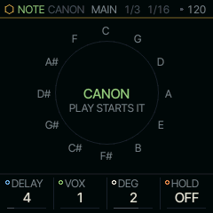
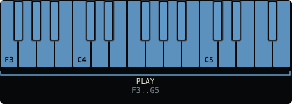

<!-- generated by tools/gen_docs.py from docs/src/note/canon.md and the firmware: edit the source, not this file -->
# CANON

CANON answers what you play. A note you play sounds at once and goes into a ring of 64 steps; one to three voices
play it back, each DELAY steps after the one before and DEG scale degrees away. DEG 0 is a round, DEG 2 stacks
thirds, and DEG -7 answers an octave down. HOLD then loops the ring on its own, so you can play over your own canon.

 **NOTE nut:** answers what you play. **Reach it:** the slot picker. **ALGORITHM turns:** `DELAY`.

## Playing it

Press PLAY and play a line (stopped, the answers come while you hold a key). Each step of the part's sequencer (DIV on its SEQ page sets the step) writes the key you
last pressed into the ring, and a key still held ties on, so the answers keep your lengths. The ring holds one note
a step: play a melody, not chords.

VOX sets how many voices answer. Voice 1 comes DELAY steps after you and DEG degrees away; voice 2 comes DELAY steps
after that and another DEG degrees on, and so on. DEG counts in the shared scale, so the answers stay in key. With
SCALE on CHR it counts semitones.

HOLD stops the writing and loops the last LEN steps, the pattern's LEN on the SEQ page. The loop plays itself, its answers behind it, and
the keys sound over it without being written. Turn HOLD back to OFF to write again. Since LINE goes on playing when
you leave it, HOLD is how to keep a canon going under PLAY's parts. To keep it as steps you can edit, FREEZE it
(hold REC, press OCT+: [Sequencing](../sequencing.md)).

CANON is not on the default wheel: pick it on the PAIR page (hold HOME, tap GLO, KNOB 2) or give it a black key
with the slot picker ([The wheel](../wheel.md)). It plays on part 3, LINE, which it shares with LINES, ALIVE,
TONNETZ, ENIGMA and S+H. Give its SOUND a VOICE mode with room for the answers (POLY or a pair): a MONO sound plays
only the newest note.

## MAIN

| Knob | Label | Range | Starts at |
| --- | --- | --- | --- |
| 1 | `DELAY` | 1 .. 16 | 4 |
| 2 | `VOX` | 1 .. 3 | 1 |
| 3 | `DEG` | -7 .. 7 | 2 |
| 4 | `HOLD` | OFF LEN | OFF |

## Where it comes from

CANON is an analogue shift register for the keys, after Ornament & Crime's CopierMaschine (Patrick Dowling, Tim
Churches and Max Stadler, MIT), whose outputs read one ring at stages behind its input and whose HOLD freezes the
ring so the outputs loop it. `firmware/src/canon.c` is written fresh for SQRL-1's note engines (databurn, MIT).
