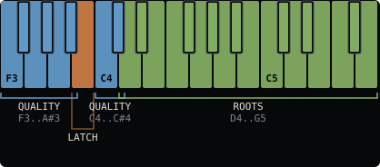
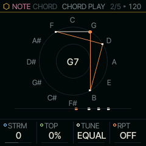
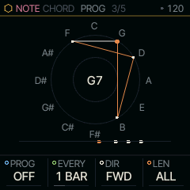

<!-- generated by tools/gen_docs.py from docs/src/note/chord.md and the firmware: edit the source, not this file -->
# CHORD

CHORD plays a whole chord from one key. The left of the keyboard is a block of chord-quality keys and the rest are
roots: hold a quality with the left hand, press a root with the right, and the SOUND in front plays the chord. The
layout follows the Orchid instrument, so the hands learn it once.

 **NOTE nut:** plays a chord per key. **Reach it:** black key D#4 in the wheel. **ALGORITHM turns:** `VOIC`.

## Playing it

A root pressed with nothing else held plays its own chord. With QNT on any setting but OFF, that is the triad
(a three-note chord) the shared scale builds on the degree, so the same key gives a minor chord in a minor key. With
SCL at CHR, the default, the chords come from the major scale of ROOT. With QNT OFF every root plays a major
triad.

The nine keys from F3 to C#4 never sound. Holding one changes the chord:

| Key | Holds | Key | Holds |
|---|---|---|---|
| F#3 | DIM | F3 | 6 |
| G#3 | MIN | G3 | m7 |
| A#3 | MAJ | A3 | M7 |
| C#4 | SUS | C4 | 9 |

DIM with MAJ gives AUG, and MIN with SUS gives SUS2. With a seventh or a 6 held, 9 takes the fifth's place, so both
extensions fit.

### B3, the chord key

B3 is the one key in the block that is not a quality. What it does depends on how you use it:

- **Tap:** LATCH. The chord keeps sounding after you let go of the root, until the next root replaces it or CHORD
  leaves the front.
- **Hold, then press roots:** each key you press adds that note to every chord from now on, the same note in each
  (an A stays an A over any root), and pressing it again takes it out. Where it is already a chord tone, it is added
  an octave up. The screen names each note as it goes in
  or out.
- **Hold, then turn SELECT:** walks the chord list (MAJ, MIN, DIM, AUG, SUS2, SUS4, 6, m6, 7, MAJ7, m7, m7b5, dim7,
  7sus4, add9, 9, MAJ9, m9, 11, 13). The chord you stop on is what a bare root plays from then on. KEY at the top of
  the list returns to the root's own chord.
- **Long hold:** once something has been added or picked, a ring fills; let go after it and the chord key resets
  to STANDARD CHORDS.

### Voicings

ALGORITHM turns VOIC, the order and octave of the chord's notes. CLOSE stacks them in root position. OPEN lifts the
second tone an octave. INV1 and INV2 are the first and second inversions. +OCT adds the root an octave below (a
seventh chord drops its fifth to make room). DROP2 and DROP3 lower the second or third tone from the top by an
octave, as in the jazz voicings of those names. WIDE lifts every other tone an octave. VAR picks one of CLOSE, INV1,
INV2, DROP2 and WIDE for each chord you strike.

After the voicing, the upper tones follow your hand: when a new chord would sit more than a fifth from the last one,
they move an octave toward it, so a progression voice-leads instead of jumping. The root stays where you played it.

BASS adds the root an octave below (ROOT), or the root and its fifth (R+5).

### Gliding chords

With glide on (the GLIDE page, shared by every SOUND), GSPR gives each note of the chord its own glide time, so the
voices of a chord change arrive one after another. GORD decides which land first: RAND, the LOW notes, or the HIGH
ones.

### When a chord can't play

CHORD always plays its part polyphonically. On a SOUND whose VOICE is MONO, LEG or UNI it still plays the whole chord
(and the arp walks all of it); VCE keeps its setting for when the SOUND plays under KEYS, and the VOICE page shows it
greyed while CHORD plays the part. A kit (DRUMS) ignores chords and maps the keys itself, so MAIN shows ROOT ONLY: A
KIT.

## MAIN

BASS is the root an octave below, VOIC the voicing. QNT is the key setting: any setting but OFF gives the scale's own chords, and OFF
gives a major triad on every root. MODE is the part's arpeggiator mode, the same MODE as on the ARP page, here so a
held chord can become a pattern. The arp plays every note of the chord in the order MODE picks. Turning MODE to OFF
turns the arp off completely: HOLD and LATCH go off with it, and nothing they held keeps sounding. Under CHORD the
MODE list leaves out REPEAT (it would play only the chord's top note) and ORD (a chord's notes have no order of
pressing, so it plays as UP).

To put the whole NOTE side back to how CHORD starts, hold **ARP** and then hold **OCT-** until the ring fills: the
arp (MODE OFF, its RATE, OCT, GATE, SWG, PROB, HOLD and ORD), MAIN (BASS, VOIC, QNT), CHORD PLAY (STRM, TOP, TUNE,
RPT), PROG's four and B3's added notes, chosen chord and LATCH all return to their defaults. The take, its knob moves and the
SOUND stay as they are, and holding REC to its first ring brings the settings back (see
[the resets](../shell.md#resets)).

| Knob | Label | Range | Starts at |
| --- | --- | --- | --- |
| 1 | `BASS` | OFF ROOT R+5 | OFF |
| 2 | `VOIC` | CLOSE OPEN INV1 INV2 +OCT DROP2 DROP3 WIDE VAR | CLOSE |
| 3 | `QNT` | OFF SNAP WHITE SEQ SEQ+T NEAR DROP CHORD | SNAP |
| 4 | `MODE` | 15 values: OFF UP DN UPDN .. CHORD | OFF |

## Pages

### CHORD PLAY

CHORD PLAY shapes how a struck chord's notes start. STRM staggers their starts: positive values strum upward from
the lowest note, negative values strum downward, and the full turn spreads them across
250 ms. Under REC a strummed chord is recorded whole into the step you pressed it in, however
wide the strum, and it plays back strummed (see [A take under CHORD](#a-take-under-chord)). TOP lifts the top note's velocity (how hard it sounds) while the inner notes fall,
so a melody played on the roots rides above its own chord; the lowest note keeps the played velocity.

TUNE JUST retunes the chord's tones to 5-limit just ratios above its root (ratios built from 2, 3 and 5), with a
harmonic seventh (7:4) in a chord with a major third and 9:5 otherwise. The FM-1 tunes in sixteenths of a semitone,
which leaves at most about 3 cents (hundredths of a semitone) of error against the exact ratio.

RPT restrikes a held or latched chord on the grid it names: 1/8T is a triplet, and 1/4. and 1/8. are dotted.
While the transport plays, the strums fall on that grid from the start of the song; stopped, they count from the
moment you press the chord. Each strum reverses direction, down then up like a guitarist's hand, with STRM's spread
(at 0 the whole chord is struck again). TOP and TUNE apply to every strum. Under REC the chord is recorded once, held
for as long as you hold it, and RPT strikes it again as it plays back. LATCH with RPT gives a rhythm part you can
leave running.

RPT and the arp take turns, so the part has one clock. With an arp mode on, turning RPT on turns the arp off (ARP
OFF: RPT STRUMS); turning an arp mode on turns RPT off (RPT OFF: THE ARP PLAYS). A project saved with both on
plays the arp.

| Knob | Label | Range | Starts at |
| --- | --- | --- | --- |
| 1 | `STRM` | -127 .. 127 | 0 |
| 2 | `TOP` | 0% .. 100% | 0% |
| 3 | `TUNE` | EQUAL JUST | EQUAL |
| 4 | `RPT` | OFF 1/4 1/8 1/8T 1/16 1/4. 1/8. | OFF |

### PROG

PROG plays a chord progression from the chord you hold. The root you hold or latch is the key, and the chord moves
through the progression's degrees of the shared scale, each built as the scale builds it: in C major, POP on C plays
C, G, Am and F. A root off the scale keeps its distance, so the progression moves with it.

| PROG | Degrees | In C major |
| --- | --- | --- |
| POP | I V vi IV | C G Am F |
| 50S | I vi IV V | C Am F G |
| JAZZ | ii V I I | Dm G C C |
| BLUES | the twelve bars: I I I I IV IV I I V IV I V | C C C C F F C C G F C G |
| ANDAL | i VII VI V, the Andalusian cadence (in a minor scale; in major it walks down from I) | Am G F E in A minor |
| PACH | Pachelbel's: I V vi iii IV I IV V | C G Am Em F C F G |
| 5THS | down the scale's fifths: I IV vii iii vi ii V I | C F Bdim Em Am Dm G C |
| SAD | vi IV I V | Am F C G |
| ROYAL | IV V iii vi | F G Em Am |

While the transport plays, a chord held or latched (B3) moves on every EVERY: HALF a bar, 1, 2 or 4 bars, counted
from the transport's start, which begins on the first chord. Stopped, each root you press plays the next chord, so
one key taps through the progression. DIR picks the way: FWD, REV, PEND (to the end and back), RAND (never the same
chord twice) or BROWN (a step either way, or stay). LEN plays only the first chords of it, or more than it has,
going round: POP at LEN 6 is I V vi IV I V.

Under REC, each chord the progression moves to is recorded as you hear it. With an arp mode on, the arp follows the
chord. RPT strikes whichever chord is sounding. With SCL at CHR the degrees come from the major scale of ROOT, and
with QNT OFF every chord is major. A project keeps PROG's four.

| Knob | Label | Range | Starts at |
| --- | --- | --- | --- |
| 1 | `PROG` | OFF POP 50S JAZZ BLUES ANDAL PACH 5THS SAD ROYAL | OFF |
| 2 | `EVERY` | HALF 1 BAR 2 BAR 4 BAR | 1 BAR |
| 3 | `DIR` | FWD REV PEND RAND BROWN | FWD |
| 4 | `LEN` | 13 values: ALL 1 2 3 .. 12 | ALL |

## A take under CHORD

A take recorded under CHORD plays back through CHORD PLAY, on whichever part CHORD plays, so it
sounds the way you played it. Turning a setting after the take changes how the take plays wherever the table says
"as it plays":

| Setting | On a take |
| --- | --- |
| STRM | as it plays: the step's notes start low to high (or high to low) across the spread |
| TOP | as it plays: the take keeps the velocity you played, TOP lifts its top note |
| RPT | as it plays: a sounding chord strikes again on RPT's grid; the strikes are never recorded, so nothing doubles |
| TUNE | as recorded: each note keeps the tuning it was played with, because the chord it was tuned against is gone |
| BASS, VOIC, QNT, the qualities, B3's notes | as recorded: they chose the notes the take holds |
| MODE (the arp as a strum) | as recorded: the arp records its own notes on each pass |
| LATCH | as recorded: a latched chord records held, its steps tied |

A strum's later notes still waiting when the step's GATE ends never start, as they don't when you let go of a key
early: a chord held over several steps plays its whole strum, a short tap at a wide STRM only its first notes.

## Where it comes from

The block layout follows Orchid (Telepathic Instruments) and Quixotic7's ChoralRoot firmware for the FM-1; SQRL-1
extends Felucca's chord keys in `firmware/src/chord.c` for it. CHORD PLAY is databurn's `chordplay.h` (MIT). PROG
follows the progressions of Ornament & Crime's Acid Curds (Patrick Dowling, Tim Churches and Max Stadler, MIT),
which step a list of scale degrees on a clock in a chosen direction; `chordprog.h` is written fresh for it
(databurn, MIT).
