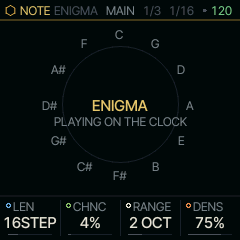
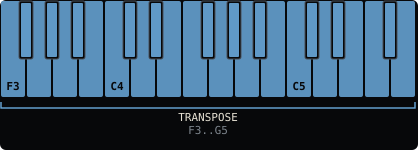

<!-- generated by tools/gen_docs.py from docs/src/note/enigma.md and the firmware: edit the source, not this file -->
# ENIGMA

ENIGMA is a Turing Machine, the looping random sequencer: a register of bits shifts once a step, and the bit that
falls off the end comes back in at the start, sometimes flipped. Left alone it repeats a phrase; with a little
chance it drifts into a new one, a note at a time.

 **NOTE nut:** loops a phrase and mutates it. **Reach it:** the slot picker. **ALGORITHM turns:** `LEN`.

## Playing it

Press PLAY. Each step of the part's sequencer (DIV on its SEQ page sets the step) shifts the register once and plays
what it now holds. LEN is the loop's length in steps: the pattern's LEN (1-64), the same knob as on the SEQ page.
CHNC is how often the returning bit flips: at 0 % the loop
repeats exactly, at the top of its range it is new every time, and in between it mutates slowly. When you find a
phrase you like, turn CHNC to 0 to lock it.

The low half of the register picks the pitch, a degree of the shared scale spread over RANGE octaves, so ENIGMA
stays in key. The high half is the gate: DENS sets how many steps sound, and because the gate bits loop with the
pitch bits, the rests repeat with the phrase.

A key moves the phrase along the scale to start from that note; the next step plays from there. Stopped, hold a key to hear the phrase: it plays as it would with the transport running, until you let go.

ENIGMA is not on the default wheel: pick it on the PAIR page (hold HOME, tap GLO, KNOB 2) or give it a black key
with the slot picker ([The wheel](../wheel.md)).

## MAIN

| Knob | Label | Range | Starts at |
| --- | --- | --- | --- |
| 1 | `LEN` | 1STEP .. 64STEP | 16STEP |
| 2 | `CHNC` | 0% .. 50% | 4% |
| 3 | `RANGE` | 1 OCT 2 OCT 3 OCT 4 OCT | 2 OCT |
| 4 | `DENS` | 0% .. 100% | 75% |

## Where it comes from

The Turing Machine is Tom Whitwell's module for Music Thing Modular. ENIGMA follows the way Hemisphere Suite's TM
applet and ENIGMA app play it (Jason Justian, MIT). `firmware/src/enigma.c` is written fresh for SQRL-1's note
engines (databurn, MIT).
