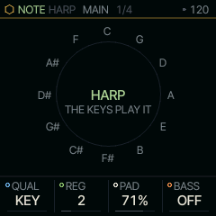
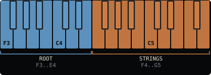
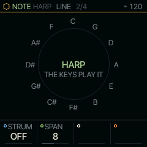

<!-- generated by tools/gen_docs.py from docs/src/note/harp.md and the firmware: edit the source, not this file -->
# HARP

HARP turns the keyboard into an Omnichord: the low twelve keys are chord buttons, the high fifteen are a strum
plate. Pick a root with the left hand and run a finger up the right half; the chord comes out one string at a time.

 **NOTE nut:** strums a chord on the keys. **Reach it:** the slot picker. **ALGORITHM turns:** `QUAL`.

## Playing it

A key from F3 to E4 picks the chord's root. QUAL sets its quality: KEY stacks thirds on that degree of the scale, so
the same key gives a minor chord in a minor scale, and a root outside the scale gets a major chord. The other QUAL
settings force one shape on every root.

The fifteen keys from F4 to G5 are the strings. Each plays one tone of the chord, climbing through the octaves, so a
run from left to right strums upward and the reverse strums down. A string still ringing when you change the chord
keeps its old note until you let go of it, so nothing hangs and nothing jumps.

PAD sounds the whole chord underneath while the root key is held, as the Omnichord's chord buttons do, so a root
key alone plays its chord; at 0 the root keys are silent and the plate plays alone. BASS adds the root an octave below the pad, so it needs PAD above 0. REG sets the plate's lowest
octave.

STRUM, on the LINE page (SELECT from MAIN), strums the plate for you: hold a root key and HARP plays its chord one
string at a time, UP, DOWN, UP+DN or RAND, over SPAN strings from the first. With the transport running it strums
on the part's DIV (the SEQ page's); stopped, in sixteenths at the tempo. Let go of the root and it stops. Change
roots as it runs and the strum starts again from the new chord's first string. The strings you play by hand still
play over it, so you can strum along.

HARP plays whichever SOUND is in front. PHYS gives plucked strings; SHOCK with PAD up gives a held brass
chord with arpeggios on top.

HARP is not on the default wheel: pick it on the PAIR page (hold HOME, tap GLO, KNOB 2) or give it a black key with
the slot picker ([The wheel](../wheel.md)).

## MAIN

| Knob | Label | Range | Starts at |
| --- | --- | --- | --- |
| 1 | `QUAL` | KEY MAJ MIN 7 m7 MAJ7 SUS4 DIM | KEY |
| 2 | `REG` | 1 .. 5 | 2 |
| 3 | `PAD` | 0% .. 100% | 71% |
| 4 | `BASS` | OFF ON | OFF |

## Pages

### LINE

| Knob | Label | Range | Starts at |
| --- | --- | --- | --- |
| 1 | `STRUM` | OFF UP DOWN UP+DN RAND | OFF |
| 2 | `SPAN` | 2 .. 15 | 8 |

## Where it comes from

The Suzuki Omnichord (1981) put chord buttons on the left and a touch strip on the right; HARP keeps that division
and maps it onto keys. The engine is `firmware/src/harp.c`, from databurn's note engines (MIT).
