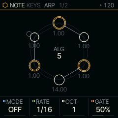
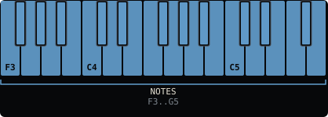

<!-- generated by tools/gen_docs.py from docs/src/note/keys.md and the firmware: edit the source, not this file -->
# KEYS

KEYS plays the keyboard as it is: each key starts one note of the SOUND in front, with the part's arpeggiator and
sequencer behind it.

 **NOTE nut:** you play. **Reach it:** black key C#4 in the wheel.

## Playing it

All 27 keys play, shifted by OCT- and OCT+. QNT on the SCALE page decides whether a key off the scale plays as it
is or snaps to the scale note at or below it.

KEYS has no page of its own: its NOTE view (tap HOME) opens on ARP, the part's arpeggiator, with SEQ after it, and the SOUND view's MAIN shows the SOUND's four knobs. Holding ARP
switches HOLD on or off. With an arp mode, the arp keeps playing the notes you let go of; with MODE at OFF, the keys
themselves latch, and a note pressed with every key up starts the next latch. Holding SEQ turns the keys into the
pattern's steps. The shared pages describe both.

Because KEYS adds nothing, it is also the clean way to hear a SOUND's presets as they were made.

## MAIN

| Knob | Label | Range | Starts at |
| --- | --- | --- | --- |
| 1 | `MODE` | 15 values: OFF UP DN UPDN .. CHORD | OFF |
| 2 | `RATE` | 15 values: 4BAR 2BAR 1/1 1/2 .. 1/32T | 1/16 |
| 3 | `OCT` | 1 .. 4 | 1 |
| 4 | `GATE` | 1% .. 100% | 50% |

## Where it comes from

KEYS is the stock Felucca keyboard path (`firmware/src/seq.c`), which every other NOTE nut replaces or sits in
front of.
