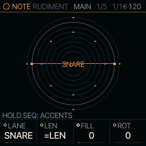
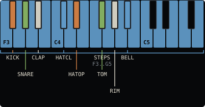
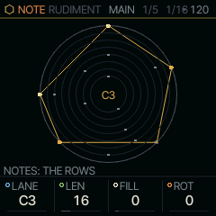
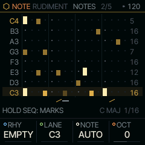
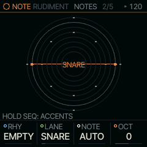
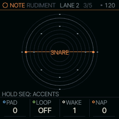
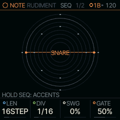

<!-- generated by tools/gen_docs.py from docs/src/note/rudiment.md and the firmware: edit the source, not this file -->
# RUDIMENT

RUDIMENT is a beat machine laid out on the keys: the white keys are sixteen steps, the black keys are eight lanes.
Each lane can run its own length, so a five-step hat against a sixteen-step kick turns into a polyrhythm (two rhythms
that only line up now and then). It is a NOTE engine: under [DRUMS](../sound/drums.md) each lane plays a drum piece,
and under any other SOUND each lane plays a note.

 **NOTE nut:** builds a beat on the keys. **Reach it:** black key A#4 in the wheel. **ALGORITHM turns:** `RHY`.

## Playing it

Tap a black key to put that lane in front, then tap white keys to turn its steps on and off. With the transport stopped,
the black key also plays that lane once and a step you turn on plays its hit, so you hear what you place; while
the pattern plays, or with REC held, the keys only edit. KNOB 2 to 4 set the
lane's length, its hits and its turn: LEN, FILL and ROT, as on Euclidean Circles. PLAY starts the pattern. Under
DRUMS the screen draws each lane as a ring, the lane in front named in the middle; under any other SOUND, as a row of
notes (below).

ALGORITHM loads a RHYTHM, a whole beat at once. Each one is named after a moon and sets every lane to a Euclidean
pattern (a number of hits spread as evenly as possible over a number of steps), with lanes of different lengths turning
against each other. Loading one replaces the beat. To get it back, hold REC until its first ring is full and let go (the
screen says UNDO BEAT): the beat returns as it was before you turned, however many rhythms you went through. RUDIMENT
starts on EMPTY, with a blank grid: turn ALGORITHM one step right for IO. For a blank grid again later, turn ALGORITHM
all the way left to EMPTY: every lane is cleared, sixteen steps long.

## MAP: Grids' drum map

Past the last moon, ALGORITHM reaches MAP. Mutable Instruments' Grids, by Emilie Gillet, then plays three lanes: KICK,
SNARE and HATCL. It reads a map of 25 drum patterns, a 5 by 5 grid, and blends the four around the place X and Y pick,
so a turn moves from one groove to its neighbours. Turning to MAP empties those three lanes, sets them to follow LEN,
and sets LEN to 32, the map's length. The other five keep their beat, and the turn is kept for UNDO BEAT.

The map plays live: nothing is written into the steps, so every turn changes the beat as it plays. The steps you place
on a map lane play as well, on top of the map's. On the keys and the screen the map's hits are faint and yours are
bright.

The map's knobs are on the ARP button, after MAIN:

| Page | Knobs |
| --- | --- |
| MAP | X and Y, the place on the map; CHAOS, which adds hits at random, the same for four cycles of the kick lane and then over again, so a loop repeats; ACC, how loud a hit must be to accent (63 is Grids' own) |
| MAP 2 | KICK, SNARE and HATS: how many of each lane's hits play, from none to all |

With EVOLVE on, MAP's changes move X or Y by AMT a little each time instead of moving hits, and BACK, a stop or
EVERY OFF puts them back. A project keeps MAP, its place and its densities. To keep a beat the map plays, hold REC
and press OCT+ (FREEZE): its hits are written into the three lanes to edit, and ALGORITHM leaves MAP. Turning ALGORITHM back to a moon loads that
rhythm, and the map stops.

## Lines: a lane per note

Under any SOUND but DRUMS, each lane is a note. NOTE MAIN keeps the rings, as on DRUMS, with the lane in front's note
in the middle: the root in the nut's colour, a note off the scale warm. The notes are the scale's eight degrees up
from ROOT, so they follow SCL; NOTE on the NOTES page sets the lane in front to a note of its own, and OCT moves them
all by octaves. The NOTES page draws the lanes as rows instead, lane 1 at the bottom, as Bitwig's Stepwise does: the
view for setting pitches.

*RUDIMENT on FM6, NOTE MAIN: the rings, the lane in front's note in the middle.*

*RUDIMENT on FM6, NOTES: an accent fills its cell, a plain hit sits low, each row stops at its LEN.*

Each row stops at its own LEN, with the number at its end, so lanes of different lengths drift against each other as the
rings do. The screen holds 16 steps and shows the page in view on every row (the ring view marks that page's arc);
a lane past 16 has a short mark per page under its number, the page in view bright. A plain hit sits low in its cell and an accent fills it. While the pattern plays, a line under each
row marks its step, and a row that sounds lights its name. The root's rows take the nut's colour; a lane set to a note
off the scale shows its name in orange. Hold SEQ and tap a white key to mark that step: once for SLIDE (a rising stroke
under it: it glides into the next, a 303's slide with a MONO or LEGATO sound and GLIDE), twice for TIE (a bar: the step
starts nothing, so what sounds holds through it), a third time to clear the mark. On a step where the lane in front has
a hit, the round starts with ACCENT (that hit fills its cell and plays at full velocity) and runs ACCENT, SLIDE, ACCENT
SLIDE, TIE, plain; the accent is that lane's alone. The screen's bottom line says HOLD SEQ: MARKS; while SEQ is held the knob cards give way to the map, WHITE: ACC SLD TIE.
A SLIDE or TIE belongs to the step's time, not to a lane: with lanes of other lengths it slides or holds whatever sounds at that point of the loop. Hits under a TIE
stay and show faintly. Tapping hits in and out and turning LEN, FILL or ROT keep the marks, REC held with a step key
erases its hits but not its mark, and a clear of every lane takes the marks too. REC held to its first ring undoes the
last mark. Under DRUMS, SEQ held and a step key only turns the accent of the lane in front's hit on or off (an
accent shows as a pale dot on its ring): a kit has no glide, and a TIE would only silence the step. The scale and the step length sit under
the grid.

Each lane below is hits/steps, and +N turns it N steps later; an empty cell is a silent lane.

| RHYTHM | METER | KICK | SNARE | CLAP | HATCL | HATOP | TOM | RIM | BELL |
| --- | --- | --- | --- | --- | --- | --- | --- | --- | --- |
| EMPTY | -- |  |  |  |  |  |  |  |  |
| IO | 4/4 | 4/16 | 2/16 +4 |  | 8/16 |  |  |  |  |
| EUROPA | 4/4 | 5/16 | 2/16 +4 |  | 9/12 |  |  |  |  |
| TITAN | 4/4 | 3/16 |  | 2/16 +4 | 7/16 +1 |  |  | 5/12 +2 |  |
| GANYMEDE | 4/4 | 4/16 | 2/16 +4 |  |  | 4/16 +2 | 2/6 |  |  |
| CALLISTO | 4/4 | 5/16 |  |  | 11/16 |  |  | 3/16 +2 | 3/8 |
| ENCELADUS | 4/4 | 4/16 |  | 2/16 +4 | 5/8 |  |  |  | 4/12 +1 |
| RHEA | 4/4 | 2/16 | 1/16 +8 |  | 8/16 +1 |  | 3/12 |  |  |
| OBERON | 4/4 | 4/16 |  |  | 12/16 | 4/16 +2 |  | 5/16 +1 |  |
| TETHYS | 3/4 | 2/12 | 2/12 +3 |  | 6/12 |  |  |  |  |
| DIONE | 3/4 | 4/12 |  | 3/12 +2 | 6/12 +1 |  |  |  | 3/8 |
| MIRANDA | 3/4 | 5/12 |  |  | 2/4 |  |  | 7/12 |  |
| PHOBOS | 5/4 | 5/20 | 2/20 +6 |  | 10/20 +1 |  |  |  |  |
| DEIMOS | 5/4 | 7/20 |  | 3/20 +5 | 7/10 |  |  |  |  |
| TRITON | 7/8 | 4/14 | 2/14 +4 |  | 7/14 |  |  |  |  |
| CHARON | 7/8 | 5/14 |  |  | 4/7 |  |  | 3/14 +2 |  |
| HYPERION | 9/8 | 4/18 |  | 2/18 +6 | 9/18 |  |  |  | 2/6 +1 |

RUDIMENT's NOTE MAIN (tap HOME for the NOTE view) holds LANE, the lane in front, then its LEN, FILL and ROT;
ALGORITHM turns the rhythm there. A lane's LEN starts at =LEN: it follows the pattern's LEN on the SEQ page. Turn it down and the
lane has its own cycle, at most the pattern's LEN, FILL how many hits are spread over it, and ROT turns the lane
round by steps. Give one lane its own LEN and leave the others alone to hear the lanes drift apart and meet again.
Every change lands at once, while it plays:

- **LEN** on a lane FILL wrote spreads its hits over the new LEN (four over 16 become four over 12); on a lane you
  placed by hand it only trims or extends, the hits staying on their steps. Steps past a shorter LEN are kept and come
  back when LEN grows again (a pattern holds 64), and a lane cut shorter than where it is plays its step 1 next.
- **ROT** turns whatever is in the lane, hits and accents, by hand or by FILL, a step a detent (ALGORITHM with the
  lane's key held does the same).
- **FILL** writes the lane again from FILL. On a lane you placed by hand the first detent only says HAND and its hit
  count; turn again within a moment to write it. REC held until its first ring is full brings the hits back
  (UNDO BEAT).

Hold a lane's black key and turn KNOB 2, 3 or 4 on any page for that lane's LEN, FILL or ROT, without going back to
MAIN. KNOB 1 with a lane key held is the lane's DIV, the length of its step against the pattern's: x2, 3/2, 4/3, x1
(the default), 3/4, 2/3, 1/2, 1/3, 1/4. At 2/3 a lane plays three of its steps in the time of two, triplet hats over
a straight kick; at 1/2 it runs twice as fast, at x2 half as fast. LEN and DIV together give the polyrhythms of a
Stepwise: a hat of 12 steps at 3/4 against a 16-step kick comes round with it every bar. A lane with a DIV plays on its
own clock, on the pattern's swing, from the transport's start, and wraps at its own LEN or the pattern's. A logic lane,
and a lane MAP plays, keep the pattern's step (the toast says AT x1 HERE); a new rhythm puts every lane back to x1.
Past 16 steps the two black keys past C5 page the white keys, with nothing held (see
[Step pages](../sequencing.md#step-pages)). SEQ + OCT+ doubles the whole beat, lanes with their own LEN too. Hold a
white key to edit that step: C#5 ACCENT, D#5 SLIDE, F#5 TIE, and the lane keys stack hits on it
([Hold a step](../sequencing.md#hold-a-step-to-edit-it)). A project keeps each lane's LEN, FILL, ROT and DIV.

### Logic lanes

Turn FILL left past 0 on lanes 3 to 8 and the lane stops having hits of its own: it plays the two lanes above it
through a logic op, as a logic module or Cold Mac does with gates. A is the lane just above, B the one above that
(for the open hat, A is the closed hat and B the clap). The ops, one detent each:

| FILL | Op | It plays when |
| --- | --- | --- |
| AND | A and B | both hit: where two cycles agree |
| OR | A or B | either hits: two thin lanes merged |
| XOR | one of them | exactly one hits: two lengths make a long figure (16 against 12 repeats every 48 steps) |
| NOR | neither | neither hits: the hat between the kick and the snare |
| A-B | A unless B | A hits and B does not: B mutes A |
| FLIP | every other A | A's 1st, 3rd, 5th hit; B starts the count over |
| LATCH | from A until B | every step from an A hit until a B hit: a roll A starts and B stops |

A logic lane keeps its own note or drum piece, and a hit is accented when the lanes it came from were. Logic lanes can
take each other: lane 5 set to AND reads lanes 4 and 3, even when lane 4 is itself a logic lane. The lines view shows
the op where the lane's LEN would be (LAT for LATCH). Lanes 1 and 2 have no two lanes above them and stop at 0.

Under DRUMS each lane plays a piece of the kit. Under any other SOUND each lane plays a note: by default the shared
SCALE's degrees up from its ROOT, lane 1 the root in octave 3 and lane 8 an octave above, so the lanes follow SCL. The
NOTE page (ARP) sets a lane's note of its own, and OCT moves the default notes by octaves.

With a lane key held:

- ALGORITHM nudges that lane's hits a step earlier or later, round the loop.
- PRESETS mutates the lane: one hit moves to an empty neighbour, so the pattern drifts while its density stays.

REC works as an eraser here. Hold REC and tap a white key to clear that step on every lane. Hold REC and a lane key
while stopped to clear the lane; while playing, the lane's hits disappear as the playhead passes them, so you can
erase only the bar you want. Holding REC through its first ring undoes the last take; through the second it clears
every lane (CLEAR ALL LANES), the lane in front or not; to clear one lane, use REC and its lane key.

RUDIMENT is the BEAT track, on part 4: it keeps playing when you leave it for another pair. Only one RUDIMENT pair
plays at a time: another one brought to the front replaces it. HOME + PLAY on its pair in the wheel mutes BEAT, and
again brings it back.

## MAIN

LANE picks the lane in front (its black key does too); LEN, FILL and ROT are its cycle, as above. The SOUND view's
MAIN is the SOUND's own four, DRUMS' KIT and its most used controls.

| Knob | Label | Range | Starts at |
| --- | --- | --- | --- |
| 1 | `LANE` | KICK SNARE CLAP HATCL HATOP TOM RIM BELL | KICK |
| 2 | `LEN` | =LEN | =LEN |
| 3 | `FILL` | -7 .. 64 | 0 |
| 4 | `ROT` | 0 .. 63 | 0 |

## Pages

### NOTES

RHY is the RHYTHM ALGORITHM turns, LANE the lane in front, NOTE that lane's note (AUTO: the kit's piece, or the
scale's degree) and OCT the octave of the AUTO notes.

| Knob | Label | Range | Starts at |
| --- | --- | --- | --- |
| 1 | `RHY` | 18 values: EMPTY IO EUROPA TITAN .. MAP | EMPTY |
| 2 | `LANE` | KICK SNARE CLAP HATCL HATOP TOM RIM BELL | KICK |
| 3 | `NOTE` | AUTO .. G9 | AUTO |
| 4 | `OCT` | -2 .. 2 | 0 |

### LANE 2

The lane in front's arrangement, after Pamela's PRO Workout (LINES has it too). Each change lands at once, and REC's
first ring takes a run of turns back.

- **PAD** (0 to 16) adds empty steps after the lane's FILL: its cycle is LEN + PAD, and the hits group at its start
  (3 over 5 with PAD 3 is 3 over 8, on 1 3 5). On a lane that follows the pattern's LEN, PAD takes its steps from the
  end of it. On a lane placed by hand it only lengthens the cycle.
- **LOOP** (OFF, 1, 2, 4 or 8 bars) makes the lane's chances repeat: the CHNC rolls it made from the bar you turned
  LOOP on play again every loop, so a random fill you like stays. OCT+ on this page gives it new rolls from the next
  loop. Off, every bar rolls afresh.
- **WAKE** and **NAP**: the lane plays WAKE bars (WAKE loops, with LOOP on), then rests NAP, round; NAP 0 never rests.
  A fill lane on WAKE 3 NAP 1 plays three bars and sits out the fourth. The count starts at PLAY and goes on through
  a queued pattern switch.

On the picture a napping lane is dimmed, PAD's steps are faint ticks or dashes, and a lane on LOOP has a small ring.
A project keeps all four, and LOOP's rolls, for each lane.

| Knob | Label | Range | Starts at |
| --- | --- | --- | --- |
| 1 | `PAD` | 0 .. 16 | 0 |
| 2 | `LOOP` | OFF 1 BAR 2 BAR 4 BAR 8 BAR | OFF |
| 3 | `WAKE` | 1 .. 8 | 1 |
| 4 | `NAP` | 0 .. 8 | 0 |

### SEQ

LEN is the pattern's length in steps, the one every lane at =LEN plays and the lanes' own cycles play against; SWG
swings every other step late, DIV
is the length of a step, and GATE how long each hit holds a note.

| Knob | Label | Range | Starts at |
| --- | --- | --- | --- |
| 1 | `LEN` | 1STEP .. 64STEP | 16STEP |
| 2 | `DIV` | 4BAR 2BAR 1/1 1/2 1/4 1/8 8T 1/16 16T 1/32 | 1/16 |
| 3 | `SWG` | 0% .. 100% | 0% |
| 4 | `GATE` | 1% .. 100% | 50% |

## Where it comes from

The lane grid, the per-lane Euclidean cycles and the rhythms are the shell's (`firmware/src/shell.c`); the per-lane
cycles follow ideas from POLY 2 and Euclidean Circles. The drum voices are DRUMS' ([DRUMS](../sound/drums.md)).
