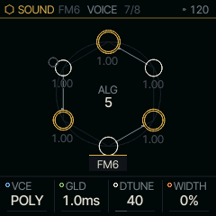
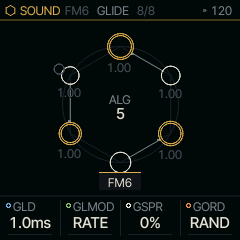
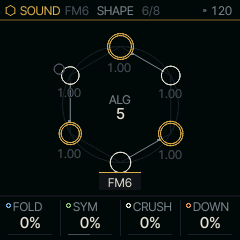
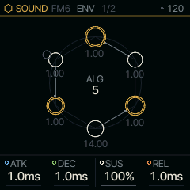
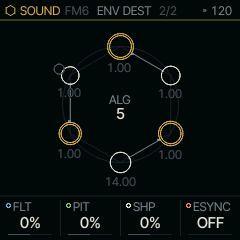
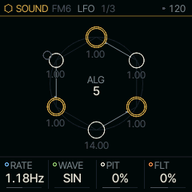
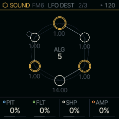
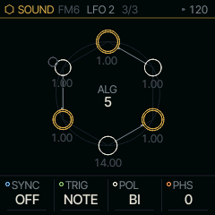

<!-- generated by tools/gen_docs.py from docs/src/pages.md and the firmware: edit the source, not this file -->
# Shared pages

Every SOUND has these pages after its own, and they work the same for every engine. They are Felucca's per-part settings
and part of the sound: SAVE stores them with it, and PRESETS brings them back. The FX and INSERT pages are in
[Effects](effects.md), ARP and SEQ in [Sequencing](sequencing.md).

## VOICE and GLIDE

EDIT walks to these after the engine's own pages.

| Knob | Label | Range | Starts at |
| --- | --- | --- | --- |
| 1 | `VCE` | POLY MONO LEG UNI | POLY |
| 2 | `GLD` | 1.0ms .. 10.0s | 1.0ms |
| 3 | `DTUNE` | 0 .. 127 | 40 |
| 4 | `WIDTH` | 0% .. 100% | 0% |

VCE sets how the SOUND uses its voices. POLY plays each key on its own voice. MONO plays one note at a time and
LEG (legato) does too, but only retriggers the envelope when you lift every key first. UNI stacks every voice on
the one note, detuned by DTUNE, up to about 40 cents either side. WIDTH spreads POLY and UNI voices left and right
of the part's pan. GLD here is the same value as GLD on GLIDE: either page turns it.

| Knob | Label | Range | Starts at |
| --- | --- | --- | --- |
| 1 | `GLD` | 1.0ms .. 10.0s | 1.0ms |
| 2 | `GLMOD` | RATE TIME | RATE |
| 3 | `GSPR` | 0% .. 100% | 0% |
| 4 | `GORD` | RAND LOW HIGH | RAND |

GLD is the glide (portamento) between notes, the same value as GLD on VOICE. GLMOD decides what it means. Under
TIME every glide takes the time shown, whatever the interval: 10.0 s is ten seconds. Under RATE, GLD is a speed, so a
wide jump takes longer than a small one: an octave takes about three quarters of the time shown (at 10.0 s, about
7.5 s), and every step of the knob is its own speed. GSPR, the glide spread, gives each note of
a chord its own glide time, up to four times GLD, and GORD sets which notes land first: LOW from the bottom up,
HIGH from the top down, RAND in a random order. With CHORD or HARP in front, a chord change then smears across the
voices like a string section moving.

## SHAPE

| Knob | Label | Range | Starts at |
| --- | --- | --- | --- |
| 1 | `FOLD` | 0% .. 100% | 0% |
| 2 | `SYM` | -100% .. +100% | 0% |
| 3 | `CRUSH` | 0% .. 100% | 0% |
| 4 | `DOWN` | 0% .. 100% | 0% |

SHAPE runs on each voice on its own, so a folded chord stays clear instead of turning to mud. FOLD drives the wave
into a wavefolder, which bends it back each time it reaches full scale; SYM biases the folds to add even harmonics.
CRUSH cuts the voice's resolution, down to 3 bits at the top. DOWN holds each sample for longer, which lowers the
sample rate and adds aliasing (high tones folding back down as metallic, unrelated pitches). All four at 0 switch
the stage off. LIZARD has its own SHAPE page, described on [LIZARD's page](sound/lizard.md).

## ENV

| Knob | Label | Range | Starts at |
| --- | --- | --- | --- |
| 1 | `ATK` | 1.0ms .. 10.0s | 1.0ms |
| 2 | `DEC` | 1.0ms .. 10.0s | 1.0ms |
| 3 | `SUS` | 0% .. 100% | 100% |
| 4 | `REL` | 1.0ms .. 10.0s | 1.0ms |

ENV is the amplitude envelope: ATK (attack), DEC (decay), SUS (sustain level) and REL (release).

| Knob | Label | Range | Starts at |
| --- | --- | --- | --- |
| 1 | `FLT` | -100% .. +100% | 0% |
| 2 | `PIT` | -100% .. +100% | 0% |
| 3 | `SHP` | -100% .. +100% | 0% |
| 4 | `ESYNC` | OFF ON | OFF |

ENV DEST sends the same envelope to the filter (FLT), the pitch (PIT) and the shape stage (SHP), each by its own
amount and either way. ESYNC turns ATK, DEC and REL into note values that follow the tempo.

## LFO

| Knob | Label | Range | Starts at |
| --- | --- | --- | --- |
| 1 | `RATE` | .05Hz .. 40.0Hz | 1.18Hz |
| 2 | `WAVE` | SIN TRI SAW SQR S&H | SIN |
| 3 | `PIT` | -100% .. +100% | 0% |
| 4 | `FLT` | -100% .. +100% | 0% |

Each part has one LFO. RATE sets its speed, WAVE its shape (S&H is a random value held for each cycle), and PIT and
FLT how far it moves the pitch and the filter.

| Knob | Label | Range | Starts at |
| --- | --- | --- | --- |
| 1 | `PIT` | -100% .. +100% | 0% |
| 2 | `FLT` | -100% .. +100% | 0% |
| 3 | `SHP` | -100% .. +100% | 0% |
| 4 | `AMP` | 0% .. 100% | 0% |

LFO DEST adds the shape stage (SHP) and the level (AMP, for tremolo) to the destinations.

| Knob | Label | Range | Starts at |
| --- | --- | --- | --- |
| 1 | `SYNC` | 11 values: OFF 4BAR 2BAR 1/1 .. 1/32 | OFF |
| 2 | `TRIG` | NOTE FREE | NOTE |
| 3 | `POL` | BI UNI | BI |
| 4 | `PHS` | 0 .. 127 | 0 |

SYNC locks the LFO to a note value of the tempo instead of RATE. TRIG NOTE restarts it with each new phrase (a
note after all keys were up); FREE lets it run. POL makes it bipolar, swinging both ways, or unipolar, only up.
PHS is where in its cycle a restart begins.
