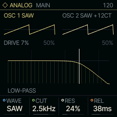
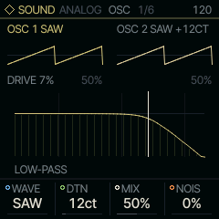
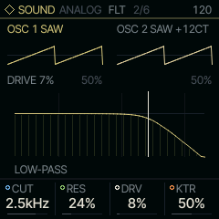
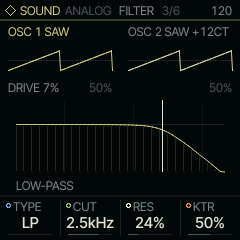

<!-- generated by tools/gen_docs.py from docs/src/sound/analog.md and the firmware: edit the source, not this file -->
# ANALOG

ANALOG is a virtual analog synth: two oscillators, noise and drive into a resonant filter, for anything that
starts with a saw and a low-pass.

 **SOUND nut:** filters two oscillators. **Reach it:** white key A4 in the wheel. **ALGORITHM turns:** `WAVE`.

**Engine:** `ANALOG`, 12 factory sounds

## Playing it

MAIN holds WAVE, CUT and RES, the filter's cutoff and resonance, and REL, the release (ATK is on ENV).
Sweep CUT while holding a chord, or turn RES up and play low for squelch.

ANALOG is on A4 of the default wheel. With
[LINES](../note/lines.md) it plays an acid line: its FILTER page is the 303's.

## MAIN

| Knob | Label | Range | Starts at |
| --- | --- | --- | --- |
| 1 | `WAVE` | SAW SQR TRI SIN PWM SYNC SUB | SAW |
| 2 | `CUT` | 30Hz .. 16.0kHz | 2.5kHz |
| 3 | `RES` | 0% .. 100% | 24% |
| 4 | `REL` | 1.0ms .. 10.0s | 38ms |

## Pages

### OSC

WAVE picks the oscillator pair: SAW, SQR, TRI, SIN and PWM play two of the same wave, detuned by DTN; MIX blends
them, and NOIS adds noise. Two settings change what the knobs mean. SYNC hard-syncs the second saw to the first
(it restarts every time the first does), and DTN, shown as SYNC, sets how far above the first it sits: sweep it
from the envelope or an LFO on SHP for a sync sweep. SUB makes the second oscillator a square an octave down,
and MIX, shown as SUB, sets its level.

| Knob | Label | Range | Starts at |
| --- | --- | --- | --- |
| 1 | `WAVE` | SAW SQR TRI SIN PWM SYNC SUB | SAW |
| 2 | `DTN` | 0ct .. 127ct | 12ct |
| 3 | `MIX` | 0% .. 100% | 50% |
| 4 | `NOIS` | 0% .. 100% | 0% |

### FLT

DRV drives the filter's input. KTR is key tracking, how far the cutoff follows the note you play.

| Knob | Label | Range | Starts at |
| --- | --- | --- | --- |
| 1 | `CUT` | 30Hz .. 16.0kHz | 2.5kHz |
| 2 | `RES` | 0% .. 100% | 24% |
| 3 | `DRV` | 0% .. 100% | 8% |
| 4 | `KTR` | 0% .. 100% | 50% |

### FILTER

TYPE chooses low-pass, band-pass or high-pass. All three peak alike at the cutoff, so switching keeps the level.

| Knob | Label | Range | Starts at |
| --- | --- | --- | --- |
| 1 | `TYPE` | LP BP HP | LP |
| 2 | `CUT` | 30Hz .. 16.0kHz | 2.5kHz |
| 3 | `RES` | 0% .. 100% | 24% |
| 4 | `KTR` | 0% .. 100% | 50% |

### Factory sounds

`SAW LEAD`, `SOFT PAD`, `SQR BASS`, `PWM STR`, `ACID`, `SINE KEY`, `RAVE`, `SUB BASS`, `PLUCK`, `BRASS`, `WIND`, `STRINGS`

## Where it comes from

`firmware/src/eng_analog.c`, Felucca's engine (GPL-3.0), by Leo Kuroshita, Hügelton Instruments. The filter is
Simper's trapezoidal state-variable filter.
