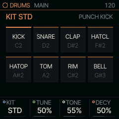
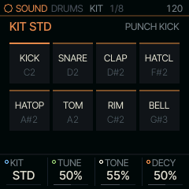
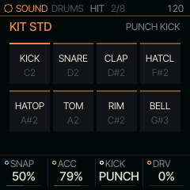
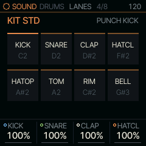
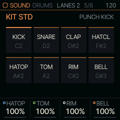
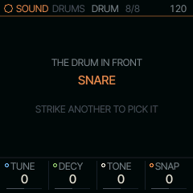

<!-- generated by tools/gen_docs.py from docs/src/sound/drums.md and the firmware: edit the source, not this file -->
# DRUMS

DRUMS plays drum kits. Each key of a kit is a drum piece: with KEYS you play the kit from the keys, and with
[RUDIMENT](../note/rudiment.md), its NOTE engine, eight lanes of steps play eight of its pieces.

 **SOUND nut:** plays drum kits. **Reach it:** white key F4 in the wheel. **ALGORITHM turns:** `KIT`.

**Engine:** `DRUM`, 5 factory sounds

## Playing it

Under KEYS the keys play the General MIDI drum map, as a keyboard does: the kick, the snare and the hats sit on
their usual notes. Hold HOME, press F4 and then A#4 for DRUMS with RUDIMENT, the beat machine.

PRESETS walks the kits. MAIN holds the kit and its most used controls.

## MAIN

| Knob | Label | Range | Starts at |
| --- | --- | --- | --- |
| 1 | `KIT` | STD 80 10 66 55 77 DEEP TIGHT PERC DIGI | STD |
| 2 | `TUNE` | 0% .. 100% | 50% |
| 3 | `TONE` | 0% .. 100% | 55% |
| 4 | `DECY` | 0% .. 100% | 50% |

## Pages

### KIT

KIT picks the drum kit: STD is Felucca's own, DIGI is SQRL-1's, and the others are model kits. DIGI's voices are
short and simple on purpose: a sine kick with a fast drop and a click, a white-noise snare, three-burst claps, hats of
pure high-passed noise, and on the last three lanes a POP (a sine falling two octaves), a TICK (a 3 kHz sine and its
octave) and a BLIP (two raw squares an octave apart, aliasing as a chip does). Each is simple enough that TUNE, DECY,
TONE and SNAP on the DRUM page describe it whole, so they are the ones to design your own clicks and kicks from. TUNE, TONE and DECY move every piece
from its designed sound together. On HIT, SNAP is each piece's extra character (the kick's drive, the snare's
snappiness, the clap's spread, the hats' noise), ACC the accent, KICK the kick's type, and DRV a soft clip on every
hit.

| Knob | Label | Range | Starts at |
| --- | --- | --- | --- |
| 1 | `KIT` | STD 80 10 66 55 77 DEEP TIGHT PERC DIGI | STD |
| 2 | `TUNE` | 0% .. 100% | 50% |
| 3 | `TONE` | 0% .. 100% | 55% |
| 4 | `DECY` | 0% .. 100% | 50% |

### HIT

| Knob | Label | Range | Starts at |
| --- | --- | --- | --- |
| 1 | `SNAP` | 0% .. 100% | 50% |
| 2 | `ACC` | 0% .. 100% | 79% |
| 3 | `KICK` | PUNCH ROUND | PUNCH |
| 4 | `DRV` | 0% .. 100% | 0% |

### LANES

These pages set the level of each of the kit's eight pieces, kick to bell, under KEYS and RUDIMENT alike. 100 % plays
the kit as designed. A level follows the piece: a RUDIMENT lane whose NOTE strikes another piece plays at that piece's
level.

| Knob | Label | Range | Starts at |
| --- | --- | --- | --- |
| 1 | `KICK` | 0% .. 100% | 100% |
| 2 | `SNARE` | 0% .. 100% | 100% |
| 3 | `CLAP` | 0% .. 100% | 100% |
| 4 | `HATCL` | 0% .. 100% | 100% |

### LANES 2

| Knob | Label | Range | Starts at |
| --- | --- | --- | --- |
| 1 | `HATOP` | 0% .. 100% | 100% |
| 2 | `TOM` | 0% .. 100% | 100% |
| 3 | `RIM` | 0% .. 100% | 100% |
| 4 | `BELL` | 0% .. 100% | 100% |

### DRUM

One drum's own sound: TUNE, DECY, TONE and SNAP move only that drum, on top of the kit-wide knobs; 0 is the drum as
designed. The screen names the drum it sets. Under RUDIMENT it is the drum the lane in front strikes (tap its black key;
a lane whose NOTE is set to another drum sets that drum); under KEYS it is the drum you played last, so strike a snare
and turn. A project keeps each part's drums, and DRUMS keeps them while another SOUND is in front or PRESETS walks to
another kit. SAVE keeps them with the sound on the FM-1, and a backup keeps them too; the editor copies a saved DRUMS
sound's kit only.

| Knob | Label | Range | Starts at |
| --- | --- | --- | --- |
| 1 | `TUNE` | -64 .. 63 | 0 |
| 2 | `DECY` | -64 .. 63 | 0 |
| 3 | `TONE` | -64 .. 63 | 0 |
| 4 | `SNAP` | -64 .. 63 | 0 |

### Factory sounds

`DRUM KIT`, `DEEP KIT`, `TIGHT KIT`, `PERC KIT`, `DIGI KIT`

## Where it comes from

The drum voices are Felucca's DRUM engine (`firmware/src/eng_drum.c`, `firmware/src/drum_voice.c`, GPL-3.0).
