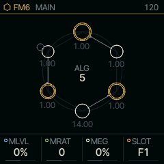
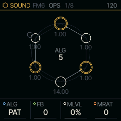
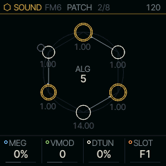
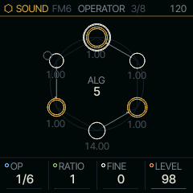
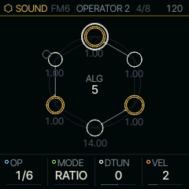
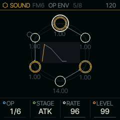

<!-- generated by tools/gen_docs.py from docs/src/sound/fm6.md and the firmware: edit the source, not this file -->
# FM6

FM6 is six-operator FM synthesis (frequency modulation: sine oscillators, called operators, bending each other's
pitch to make harmonics), in the family of the 1983 Yamaha DX7. Each part holds a whole patch; the knobs reshape it
without opening it up.

 **SOUND nut:** plays six-operator FM. **Reach it:** white key C4 in the wheel. **ALGORITHM turns:** `ALG`.

**Engine:** `FM6`, 8 factory sounds

## Playing it

The keys play notes, up to six at once on a part. PRESETS walks the factory patches, then any you have saved.
ALGORITHM picks the algorithm, the wiring of the six operators; PAT keeps the one the patch was made with.

MAIN's four knobs are macros that act on the whole patch:

- MLVL raises or lowers every modulator at once. Up is brighter and harsher, down is closer to sine waves.
- MRAT shifts the modulators' frequency ratios, which changes the harmonic series. Small moves are the useful ones.
- MEG stretches or shortens the modulators' envelopes: positive values slow the attack of the brightness, negative
  values make it snap.
- SLOT loads a factory patch (F), a voice from the bank in flash (B), or OWN, the part's own patch.

The screen draws the algorithm. Carriers, the operators you hear, are drawn in gold; modulators are white. The
number beside each operator is its frequency ratio.

Try TINE EP with MLVL turned down for a softer electric piano, then up for a bell-like bark. On BELL, small MRAT
moves give a different metal each step.

## MAIN

| Knob | Label | Range | Starts at |
| --- | --- | --- | --- |
| 1 | `MLVL` | -100% .. +100% | 0% |
| 2 | `MRAT` | -16 .. 16 | 0 |
| 3 | `MEG` | -100% .. +100% | 0% |
| 4 | `SLOT` | F1 .. B32 | F1 |

## Pages

### OPS

FB is feedback, an operator modulating itself for a buzzier tone. It adds to the patch's own feedback.

| Knob | Label | Range | Starts at |
| --- | --- | --- | --- |
| 1 | `ALG` | PAT .. 32 | PAT |
| 2 | `FB` | -7 .. 7 | 0 |
| 3 | `MLVL` | -100% .. +100% | 0% |
| 4 | `MRAT` | -16 .. 16 | 0 |

### PATCH

VMOD raises the modulators' velocity sensitivity, and DTUN spreads the carriers apart in pitch for a chorused
sound.

| Knob | Label | Range | Starts at |
| --- | --- | --- | --- |
| 1 | `MEG` | -100% .. +100% | 0% |
| 2 | `VMOD` | -7 .. 7 | 0 |
| 3 | `DTUN` | 0% .. 100% | 0% |
| 4 | `SLOT` | F1 .. B32 | F1 |

### OPERATOR

These pages edit one operator at a time. The first knob, OP, picks the operator; the selected one gets a double
ring in the picture. OPERATOR sets its RATIO, FINE tuning and output LEVEL. OPERATOR 2 sets MODE (a ratio of the
note, or a fixed frequency), DTUNE and VEL, its velocity sensitivity. OP ENV edits its envelope: STAGE picks one of
the four stages, RATE and LEVEL set it, and the envelope is drawn over the picture.

Edits here change the part's own patch, and a factory patch you edit shows OWN in SLOT from then on. SAVE stores
it as a user preset.

### OPERATOR 2

### OP ENV

### Factory sounds

`TINE EP`, `BELL`, `FM BASS`, `BRASS`, `PAD`, `MARIMBA`, `ORGAN`, `PLUCK`

## Where it comes from

The synthesis is msfa, the core of the Dexed DX7 emulator, ported to integer C (Apache-2.0). The FM6 engine around it
is Felucca's (GPL-3.0), in `firmware/src/eng_fm6.c` and `firmware/src/fm6_core.c`.
