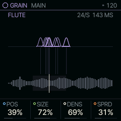
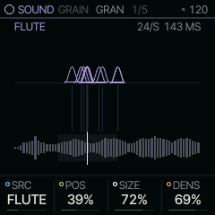
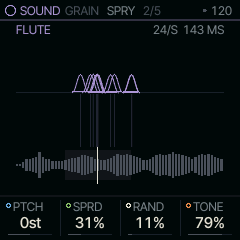

<!-- generated by tools/gen_docs.py from docs/src/sound/grain.md and the firmware: edit the source, not this file -->
# GRAIN

GRAIN plays clouds of tiny slices (grains) cut from the SAMPLE instruments or your own samples. Hold a note and
it becomes a texture, frozen at one spot or drifting through the sound.

 **SOUND nut:** scatters grains of a sample. **Reach it:** a custom build, FELUCCA_GRAIN=1 (else on PHYS). **ALGORITHM turns:** `POS`.

**Engine:** `GRAIN`, 4 factory sounds

## Playing it

POS on MAIN is where in the sample the grains come from. SIZE is how long each grain
lasts, DENS how many start every second, and SPRD how far they scatter around POS. With SPRD at 0 the position
freezes and the note holds one moment of the sample; raise it and the cloud wanders.

An LFO on SHP scans POS through the sample; ENV on SHP sweeps it once per note.

GRAIN is [on the sidelines](../sidelines.md): SQRL-1's build leaves it out. A custom build with `FELUCCA_GRAIN=1`
brings it back, picked on the PAIR page (hold HOME, tap GLO, KNOB 1). Without it, a GRAIN sound in a project or a
saved sound plays on PHYS.

## MAIN

| Knob | Label | Range | Starts at |
| --- | --- | --- | --- |
| 1 | `POS` | 0% .. 100% | 39% |
| 2 | `SIZE` | 0% .. 100% | 72% |
| 3 | `DENS` | 0% .. 100% | 69% |
| 4 | `SPRD` | 0% .. 100% | 31% |

## Pages

### GRAN

SRC picks the material: one of the SAMPLE sets or a user slot (USR1 to USR3). An empty slot plays a plain sine
instead of grains, so a missing sample is easy to hear.

| Knob | Label | Range | Starts at |
| --- | --- | --- | --- |
| 1 | `SRC` | PIANO FLUTE SAX USR1 USR2 USR3 | FLUTE |
| 2 | `POS` | 0% .. 100% | 39% |
| 3 | `SIZE` | 0% .. 100% | 72% |
| 4 | `DENS` | 0% .. 100% | 69% |

### SPRY

PTCH transposes the grains in semitones. RAND detunes each grain at random (up to an octave either way at the top)
and plays some of them backwards. TONE is a low-pass over the cloud.

| Knob | Label | Range | Starts at |
| --- | --- | --- | --- |
| 1 | `PTCH` | -24st .. +24st | 0st |
| 2 | `SPRD` | 0% .. 100% | 31% |
| 3 | `RAND` | 0% .. 100% | 11% |
| 4 | `TONE` | 0% .. 100% | 79% |

### Factory sounds

`CLOUD PAD`, `GLITCH`, `FROZEN`, `SHIMMER`

## Where it comes from

`firmware/src/eng_grain.c`, Felucca's own design (GPL-3.0), by Leo Kuroshita, Hügelton Instruments. It reads the
same instruments as SAMPLE (Versilian Studios, CC0 1.0).
