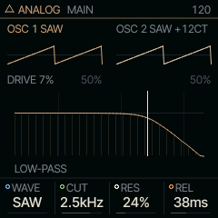
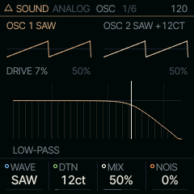
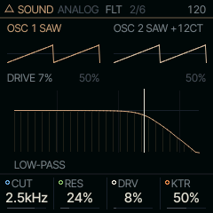
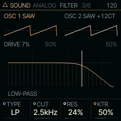

<!-- generated by tools/gen_docs.py from docs/src/sound/library.md and the firmware: edit the source, not this file -->
# LIBRARY

LIBRARY puts most of the engines on one key. PRESETS walks all their factory sounds as a single list, with no trip to
the wheel.

 **SOUND nut:** walks most engines on one key. **Reach it:** a custom build, FELUCCA_LIBRARY=1 (else on SHOCK). **ALGORITHM turns:** the engine's first EDIT knob.

**Engine:** `ANALOG`, 12 factory sounds

LIBRARY is [on the sidelines](../sidelines.md): SQRL-1's build leaves it out, and SHOCK has its key, E4. A custom
build with `FELUCCA_LIBRARY=1` brings it back, picked on the PAIR page (hold HOME, tap GLO, KNOB 1).

## Playing it

Each step of PRESETS loads the next factory sound, and the engine changes when the list crosses into the next
engine's sounds. The list wraps round at the end. Hold GLO and turn PRESETS to jump a whole engine at a
time, landing on its first sound. Your saved sounds are not in this list: PRESETS walks them under an engine's own
SOUND.

The pages follow the engine that is playing. MAIN shows that engine's own four knobs, EDIT walks its pages, and
ALGORITHM turns its first parameter. The tables below show LIBRARY as it starts, on ANALOG; the page for each
engine has the rest.

The keys play notes. The screen shows the engine's picture where it has one, and the seed-of-life pattern where it
does not.

## Engines in the list

[ANALOG](../sound/analog.md), [FM6](../sound/fm6.md), [PHASE](../sound/phase.md), [LOFI](../sound/lofi.md), [SAMPLE](../sound/sample.md), [VOICE](../sound/voice.md), [TRIO](../sound/trio.md), [WHEEL](../sound/wheel.md), [GRAIN](../sound/grain.md), [PHYS](../sound/phys.md), [LIZARD](../sound/lizard.md), [SHOCK](../sound/shock.md), [SYLLABLE](../sound/syllable.md), [ORGAN](../sound/organ.md), [MOUTH](../sound/mouth.md)

## MAIN

| Knob | Label | Range | Starts at |
| --- | --- | --- | --- |
| 1 | `WAVE` | SAW SQR TRI SIN PWM SYNC SUB | SAW |
| 2 | `CUT` | 30Hz .. 16.0kHz | 2.5kHz |
| 3 | `RES` | 0% .. 100% | 24% |
| 4 | `REL` | 1.0ms .. 10.0s | 38ms |

## Pages

### OSC

| Knob | Label | Range | Starts at |
| --- | --- | --- | --- |
| 1 | `WAVE` | SAW SQR TRI SIN PWM SYNC SUB | SAW |
| 2 | `DTN` | 0ct .. 127ct | 12ct |
| 3 | `MIX` | 0% .. 100% | 50% |
| 4 | `NOIS` | 0% .. 100% | 0% |

### FLT

| Knob | Label | Range | Starts at |
| --- | --- | --- | --- |
| 1 | `CUT` | 30Hz .. 16.0kHz | 2.5kHz |
| 2 | `RES` | 0% .. 100% | 24% |
| 3 | `DRV` | 0% .. 100% | 8% |
| 4 | `KTR` | 0% .. 100% | 50% |

### FILTER

| Knob | Label | Range | Starts at |
| --- | --- | --- | --- |
| 1 | `TYPE` | LP BP HP | LP |
| 2 | `CUT` | 30Hz .. 16.0kHz | 2.5kHz |
| 3 | `RES` | 0% .. 100% | 24% |
| 4 | `KTR` | 0% .. 100% | 50% |

### Factory sounds

`SAW LEAD`, `SOFT PAD`, `SQR BASS`, `PWM STR`, `ACID`, `SINE KEY`, `RAVE`, `SUB BASS`, `PLUCK`, `BRASS`, `WIND`, `STRINGS`

## Where it comes from

LIBRARY is part of the shell, `firmware/src/shell.c` (`CH_ENGINES` lists the engines in the order PRESETS walks
them). The engines are Felucca's and databurn's; their pages credit each one.
