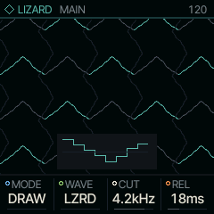
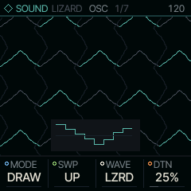
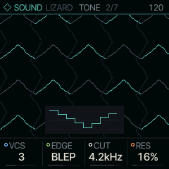
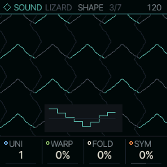
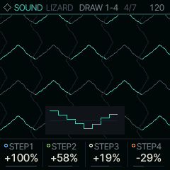
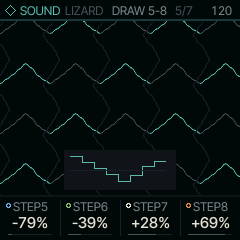

<!-- generated by tools/gen_docs.py from docs/src/sound/lizard.md and the firmware: edit the source, not this file -->
# LIZARD

LIZARD plays the oscillator modes of the Vinicius Electrik Lizard v2: waves drawn as eight steps, a switcher that
slices other waves together, Casio CZ-style cycle switching, and two stacks of detuned saws. You can draw your own
wave on the knobs.

 **SOUND nut:** draw the wave. **Reach it:** white key D4 in the wheel. **ALGORITHM turns:** `MODE`.

**Engine:** `LIZARD`, 11 factory sounds

## Playing it

The keys play notes. ALGORITHM picks MODE, the way the oscillator builds its cycle:

- DRAW plays a drawing: one cycle is eight held levels, so the wave is a staircase. WAVE picks one of the factory
  drawings, and SWP sets the order the steps are walked in (up, down, up and down, or random).
- SWCH treats each of the eight steps as a slice of a source wave (sine, triangle, saw or a flat level), all
  running at the note's pitch. WAVE picks the set of sources.
- CZ plays one whole cycle of each step's source before moving to the next, which gives the alternating-cycle tone
  of the Casio CZ synths.
- PSAW stacks several saws, VCS of them, with DTN spreading their tuning and start phases.
- SUPR is a centre saw with two below and two above. DTN is the spread and VCS the level of the outer four.

MAIN holds MODE, WAVE, the low-pass filter's CUT and REL, the release (DTN is on OSC). The screen draws the wave as it plays,
with the eight steps of the drawing underneath.

Start from LIZARD LEAD and turn ALGORITHM through the modes: the same WAVE number reads differently in each one.

## MAIN

| Knob | Label | Range | Starts at |
| --- | --- | --- | --- |
| 1 | `MODE` | DRAW SWCH CZ PSAW SUPR | DRAW |
| 2 | `WAVE` | LZRD .. WOB | LZRD |
| 3 | `CUT` | 30Hz .. 16.0kHz | 4.2kHz |
| 4 | `REL` | 1.0ms .. 10.0s | 18ms |

## Pages

### OSC

| Knob | Label | Range | Starts at |
| --- | --- | --- | --- |
| 1 | `MODE` | DRAW SWCH CZ PSAW SUPR | DRAW |
| 2 | `SWP` | UP DOWN UPDN RAND | UP |
| 3 | `WAVE` | LZRD .. WOB | LZRD |
| 4 | `DTN` | 0% .. 100% | 25% |

### TONE

EDGE sets how the steps' sharp edges are handled. BLEP (polyBLEP, a small correction at each jump that removes
most aliasing) is the default. HQ runs the same correction at twice the sample rate and costs about twice as much.
RAW leaves the edges alone, as the original hardware does, and aliases: high notes fold back into odd low tones,
which can be the point.

| Knob | Label | Range | Starts at |
| --- | --- | --- | --- |
| 1 | `VCS` | 2 .. 5 | 3 |
| 2 | `EDGE` | RAW BLEP HQ | BLEP |
| 3 | `CUT` | 30Hz .. 16.0kHz | 4.2kHz |
| 4 | `RES` | 0% .. 100% | 16% |

### SHAPE

LIZARD's SHAPE page differs from the other engines'. UNI plays up to five copies of the drawing, spread in pitch by
DTN, for a supersaw made from your own wave. WARP squeezes the first half of the steps into less of the cycle and
stretches the rest, as Casio's phase distortion does. Both work in DRAW mode only. FOLD drives the wave into a
wavefolder, and SYM biases the folder for uneven folds and even harmonics.

| Knob | Label | Range | Starts at |
| --- | --- | --- | --- |
| 1 | `UNI` | 1 .. 5 | 1 |
| 2 | `WARP` | 0% .. 100% | 0% |
| 3 | `FOLD` | 0% .. 100% | 0% |
| 4 | `SYM` | -100% .. +100% | 0% |

### DRAW 1-4

In DRAW mode, EDIT walks on to these two pages: the eight knobs are the eight levels of the cycle. They start from the
drawing WAVE plays, so the first turn edits that drawing. From then on the part plays your own drawing; turning WAVE
goes back to the factory ones, and your drawing waits on these pages: the next turn of a level brings it back.

| Knob | Label | Range | Starts at |
| --- | --- | --- | --- |
| 1 | `STEP1` | -100% .. +100% | +100% |
| 2 | `STEP2` | -100% .. +100% | +58% |
| 3 | `STEP3` | -100% .. +100% | +19% |
| 4 | `STEP4` | -100% .. +100% | -29% |

### DRAW 5-8

| Knob | Label | Range | Starts at |
| --- | --- | --- | --- |
| 1 | `STEP5` | -100% .. +100% | -79% |
| 2 | `STEP6` | -100% .. +100% | -39% |
| 3 | `STEP7` | -100% .. +100% | +28% |
| 4 | `STEP8` | -100% .. +100% | +69% |

### Factory sounds

`LIZARD LEAD`, `STAIR BASS`, `RAND DRAW`, `SWITCHER`, `CHOP SINE`, `CZ ALT`, `CZ RAND`, `PHASED SAW`, `SUPER SAW`, `RAW LIZARD`, `HQ DRAW`

## Where it comes from

The oscillator core, `firmware/src/lizard.c`, follows the modes of the Lizard v2 by Vinicius Electrik, written for
the FM-1 with uint32 phases and polyBLEP edges (GPL-3.0). SHAPE is databurn's lzshape (`firmware/src/lzshape.c`,
MIT). The engine around them is `firmware/src/eng_lizard.c`.
