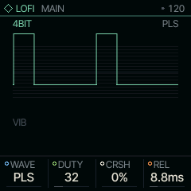
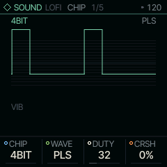
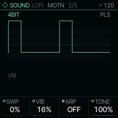

<!-- generated by tools/gen_docs.py from docs/src/sound/lofi.md and the firmware: edit the source, not this file -->
# LOFI

LOFI is a chip voice: pulse, triangle, saw, noise and a 4-bit wave RAM, with the coarse volume steps and pitch
tricks of old game consoles.

 **SOUND nut:** plays chip waves. **Reach it:** a custom build, FELUCCA_LOFI=1 (else on ANALOG). **ALGORITHM turns:** `CHIP`.

**Engine:** `LOFI`, 5 factory sounds

## Playing it

WAVE on MAIN picks the waveform. DUTY sets the pulse width; with WAVE at WRAM it picks one of the built-in 4-bit
wave tables instead (shown as WAV# and the table's name). CRSH adds bit and rate reduction, and REL is the
release.

LOFI is [on the sidelines](../sidelines.md): SQRL-1's build leaves it out. A custom build with `FELUCCA_LOFI=1` brings
it back, picked on the PAIR page (hold HOME, tap GLO, KNOB 1). Without it, a LOFI sound in a project or a saved sound
plays on ANALOG.

## MAIN

| Knob | Label | Range | Starts at |
| --- | --- | --- | --- |
| 1 | `WAVE` | PLS TRI SAW NOIS WRAM | PLS |
| 2 | `DUTY` | 0 .. 127 | 32 |
| 3 | `CRSH` | 0% .. 100% | 0% |
| 4 | `REL` | 1.0ms .. 10.0s | 8.8ms |

## Pages

### CHIP

CHIP picks the character: 4BIT, 4B/2, 8BIT and 1BIT set how coarse the output is. STEP behaves like the old sound
chips themselves: a stepped 4-bit volume envelope replaces the smooth one, the triangle becomes a 32-step
staircase, the pulse widths are 12.5, 25, 50 and 75 %, and CRSH (shown as DCY) sets the envelope's decay.

| Knob | Label | Range | Starts at |
| --- | --- | --- | --- |
| 1 | `CHIP` | 4BIT 4B/2 8BIT 1BIT STEP | 4BIT |
| 2 | `WAVE` | PLS TRI SAW NOIS WRAM | PLS |
| 3 | `DUTY` | 0 .. 127 | 32 |
| 4 | `CRSH` | 0% .. 100% | 0% |

### MOTN

MOTN holds the motion inside the note. SWP bends the pitch down after the note starts (the falling "pew"), VIB
adds vibrato, and ARP cycles the note through an octave or a major or minor chord, the way chip music fakes
chords on one voice. TONE is a low-pass: turn it down to soften the edges.

| Knob | Label | Range | Starts at |
| --- | --- | --- | --- |
| 1 | `SWP` | 0% .. 100% | 0% |
| 2 | `VIB` | 0% .. 100% | 16% |
| 3 | `ARP` | OFF OCT MAJ MIN | OFF |
| 4 | `TONE` | 0% .. 100% | 100% |

### Factory sounds

`PULSE LD`, `WAVE BASS`, `ARP 8BIT`, `WAVE LEAD`, `STEP LEAD`

## Where it comes from

`firmware/src/eng_lofi.c`, Felucca's engine (GPL-3.0), by Leo Kuroshita, Hügelton Instruments. The wave RAM tables
are the author's own shapes, built from simple formulas.
