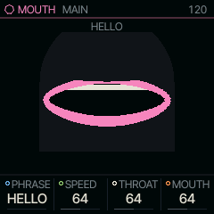
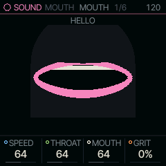
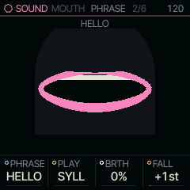
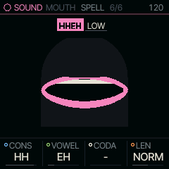

<!-- generated by tools/gen_docs.py from docs/src/sound/mouth.md and the firmware: edit the source, not this file -->
# MOUTH

MOUTH sings words. Each key sings the next piece of a built-in phrase (a syllable, a word or the whole phrase) in the
voice of an early home-computer speech program, and holds its last vowel for as long as you hold the key.

 **SOUND nut:** sings words, SAM style. **Reach it:** white key G4 in the wheel. **ALGORITHM turns:** `PHRASE`.

**Engine:** `MOUTH`, 11 factory sounds

## Playing it

The keys set the pitch, so a melody played on them sings the phrase to that tune. With PLAY on SYLL, every note sings
the next syllable: play "HEL" and "LO" as two notes. WORD sings a word a note, and PHRASE sings all of it from one
key. A phrase starts over when you pick another with PHRASE (ALGORITHM turns it). A take sings its phrase from the top
each pass: on a part that holds a take or is recording one, the phrase starts over at step 1, so the loop sings what
you sang.

Whatever follows the last vowel plays once you let go, so the release matters: with a short one, the end of a
word fades with the envelope. The factory sounds already have long releases.

On MAIN, PHRASE picks what it says and SPEED sets how fast the phonemes go (64 is the model's own pace). THROAT and MOUTH scale the first and
second formants, the two resonances that tell one vowel from another: both down make a giant, both up a child.
GRIT, on the MOUTH page, lowers the sample rate and the bit depth together, for the sound of 1980s chips. The shape stage's SHP
modulation moves MOUTH, so an LFO on SHP makes the voice chew.

## MAIN

| Knob | Label | Range | Starts at |
| --- | --- | --- | --- |
| 1 | `PHRASE` | 18 values: HELLO COUNT LALALA OOH AH .. U8 | HELLO |
| 2 | `SPEED` | 0 .. 127 | 64 |
| 3 | `THROAT` | 0 .. 127 | 64 |
| 4 | `MOUTH` | 0 .. 127 | 64 |

## Pages

### MOUTH

| Knob | Label | Range | Starts at |
| --- | --- | --- | --- |
| 1 | `SPEED` | 0 .. 127 | 64 |
| 2 | `THROAT` | 0 .. 127 | 64 |
| 3 | `MOUTH` | 0 .. 127 | 64 |
| 4 | `GRIT` | 0% .. 100% | 0% |

### PHRASE

PHRASE picks the built-in phrase and PLAY how much of it each note sings. BRTH mixes breath under the voice, and
FALL drops each note's pitch by up to an octave over its first 150 ms, as a speaking voice does at the start of a
word.

| Knob | Label | Range | Starts at |
| --- | --- | --- | --- |
| 1 | `PHRASE` | 18 values: HELLO COUNT LALALA OOH AH .. U8 | HELLO |
| 2 | `PLAY` | SYLL WORD PHRASE | SYLL |
| 3 | `BRTH` | 0% .. 100% | 0% |
| 4 | `FALL` | 0st .. +12st | +1st |

### SPELL

SPELL builds a phrase of your own, one syllable at a time, and starts from the phrase PHRASE has chosen. The row at the
top shows the phrase's syllables, the one under the cursor lit, and the mouth under it shows the shape that syllable's
vowel makes. SELECT moves the cursor instead of the page, so tap EDIT to leave; the phrase you are building is
still there when you come back, unless PHRASE picked another meanwhile. OCT+ adds a copy of the cursor's syllable after
it, and OCT- takes it away (one always stays; a phrase holds 24 sounds at most).

The four knobs edit the cursor's syllable. CONS is the consonant just before the vowel and CODA the first one after
it; their lists run from the lips to the throat, and the dash takes the consonant away. VOWEL picks the vowel, LEN
makes it shorter or longer. Hold a key while you turn VOWEL and the syllable sings at once, moving from one vowel
to the next as you turn, like a talk box.

To type a phrase instead, hold GLO on SPELL: the keys become letters, F3 A up to F#5 Z, with G5 a space, and OCT- takes
the last letter back. The screen shows the letters on the keys and what you have typed. Let go of GLO and the text
is spoken into the phrase, by English spelling rules, its syllables split at the vowels.

SAVE on SPELL keeps the phrase as one of your own, U1 to U8, which PHRASE then plays like the built-in ones: turn SELECT
to pick the slot and press OCT+. User phrases survive power-off; they are written with the settings once the sound is
quiet. While the transport runs, SAVE says STOP TO SAVE.

| Knob | Label | Range | Starts at |
| --- | --- | --- | --- |
| 1 | `CONS` | 25 values: - B P M .. Y | HH |
| 2 | `VOWEL` | 15 values: IY IH EY EH .. OY | EH |
| 3 | `CODA` | 25 values: - B P M .. Y | - |
| 4 | `LEN` | SHORT NORM LONG | NORM |

### Factory sounds

`HELLO`, `COUNT IN`, `LA LA LA`, `OOH AH`, `DATA BURN`, `ROBOT 82`, `DO RE MI`, `GIANT`, `TINY`, `WHISPER`, `GRIT`

## Where it comes from

The voice follows S.A.M., the Software Automatic Mouth, a speech program for 1980s home computers: a phrase is a
string of phonemes, each with its own length, gliding into the next. MOUTH sings forty of them through SYLLABLE's
formant synthesizer (`firmware/src/syllable.c`, unchanged), in integers. The engine is
`firmware/src/mouth.c` and `eng_mouth.c`, from databurn (MIT).
