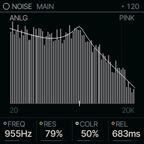
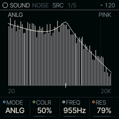
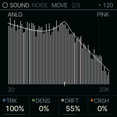

<!-- generated by tools/gen_docs.py from docs/src/sound/noise.md and the firmware: edit the source, not this file -->
# NOISE

NOISE runs noise through a resonant filter: white noise for wind and rain, digital shift registers for clicks,
buzzes and metallic tones.

 **SOUND nut:** filters noise. **Reach it:** a custom build, FELUCCA_NOISE=1 (else on ANALOG). **ALGORITHM turns:** `MODE`.

**Engine:** `NOISE`, 4 factory sounds

## Playing it

FREQ on MAIN is the filter's frequency and RES its resonance: at 0 the filter is a low-pass, and as RES rises it
narrows into a band-pass that whistles at FREQ. COLR tilts the noise from white through pink to brown (darker,
like distant surf). REL is the release.

NOISE is [on the sidelines](../sidelines.md): SQRL-1's build leaves it out. A custom build with `FELUCCA_NOISE=1`
brings it back, picked on the PAIR page (hold HOME, tap GLO, KNOB 1). Without it, a NOISE sound in a project or a
saved sound plays on ANALOG.

## MAIN

| Knob | Label | Range | Starts at |
| --- | --- | --- | --- |
| 1 | `FREQ` | 30Hz .. 16.0kHz | 955Hz |
| 2 | `RES` | 0% .. 100% | 79% |
| 3 | `COLR` | 0% .. 100% | 50% |
| 4 | `REL` | 1.0ms .. 10.0s | 683ms |

## Pages

### SRC

MODE picks the source:

- ANLG: white noise, with random impulses mixed in.
- DUST: the impulses alone, for crackle and drops through the filter.
- LFSR: a long shift register (a digital noise generator) clocked above the key, from hiss to the coarse noise of
  old game consoles.
- META: one short register sequence repeated once per period of the note, which gives a pitched metallic tone.

| Knob | Label | Range | Starts at |
| --- | --- | --- | --- |
| 1 | `MODE` | ANLG DUST LFSR META | ANLG |
| 2 | `COLR` | 0% .. 100% | 50% |
| 3 | `FREQ` | 30Hz .. 16.0kHz | 955Hz |
| 4 | `RES` | 0% .. 100% | 79% |

### MOVE

TRK makes FREQ follow the keyboard, so a melody plays a tune through the filter. DENS sets how many impulses fire.
DRFT lets the filter and the clock wander slowly at random. CRSH adds sample-and-hold and fewer bits (in ANLG and
DUST).

In LFSR and META two knobs change job. DENS becomes LEN, which picks the register's length in LFSR and the sequence
in META. CRSH becomes CLK, the register's clock in semitones above the key.

| Knob | Label | Range | Starts at |
| --- | --- | --- | --- |
| 1 | `TRK` | 0% .. 100% | 100% |
| 2 | `DENS` | 0% .. 100% | 0% |
| 3 | `DRFT` | 0% .. 100% | 55% |
| 4 | `CRSH` | 0% .. 100% | 0% |

### Factory sounds

`WIND`, `RAIN`, `ARCADE`, `METAL`

## Where it comes from

`firmware/src/eng_noise.c`, Felucca's engine (GPL-3.0), by Leo Kuroshita, Hügelton Instruments.
