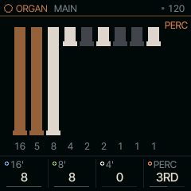
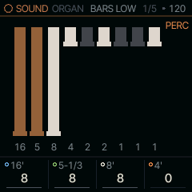
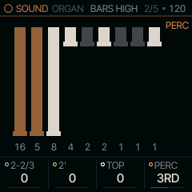

<!-- generated by tools/gen_docs.py from docs/src/sound/organ.md and the firmware: edit the source, not this file -->
# ORGAN

ORGAN is a tonewheel organ (an organ that builds each note from a set of sine "wheels") played from its drawbars.
Pull the bars up and down to set the registration (the mix of pipe pitches), then add percussion for a struck attack.

 **SOUND nut:** pulls tonewheel drawbars. **Reach it:** a custom build, FELUCCA_ORGAN=1 (else on ANALOG). **ALGORITHM turns:** `PERC`.

**Engine:** `ORGAN`, 9 factory sounds

## Playing it

MAIN holds the three drawbars that matter most, 16', 8' and 4', plus PERC. With 8' alone you hear the plain note;
16' adds the octave below and 4' the octave above. A drawbar's numbers work as on the console: 0 is silent, and
each step up adds about 3 dB (decibels; 3 dB is about 1.4 times the level).

PERC adds a decaying 2nd (4') or 3rd (2-2/3') harmonic to the attack, fast (about 0.2 s) or slow (the S settings,
about a second). As on the real instrument it is single trigger: only a note struck with no other key held
gets it, so legato lines stay smooth and detached notes click and pop. Every note also starts with a short key
click, the sound of the key contacts closing.

ORGAN is [on the sidelines](../sidelines.md): SQRL-1's build leaves it out. A custom build with `FELUCCA_ORGAN=1`
brings it back, picked on the PAIR page (hold HOME, tap GLO, KNOB 1). Without it, an ORGAN sound in a project or a
saved sound plays on ANALOG.

## MAIN

| Knob | Label | Range | Starts at |
| --- | --- | --- | --- |
| 1 | `16'` | 0 .. 8 | 8 |
| 2 | `8'` | 0 .. 8 | 8 |
| 3 | `4'` | 0 .. 8 | 0 |
| 4 | `PERC` | OFF 2ND 3RD 2ND S 3RD S | 3RD |

## Pages

### BARS LOW

The console's first four drawbars: 16', 5-1/3' (the fifth above the note), 8' and 4'.

| Knob | Label | Range | Starts at |
| --- | --- | --- | --- |
| 1 | `16'` | 0 .. 8 | 8 |
| 2 | `5-1/3` | 0 .. 8 | 8 |
| 3 | `8'` | 0 .. 8 | 8 |
| 4 | `4'` | 0 .. 8 | 0 |

### BARS HIGH

2-2/3' and 2', then TOP, which moves the console's three highest bars (1-3/5', 1-1/3' and 1') together, and PERC
again. Nine drawbars do not fit on eight knobs; TOP is where they meet.

| Knob | Label | Range | Starts at |
| --- | --- | --- | --- |
| 1 | `2-2/3` | 0 .. 8 | 0 |
| 2 | `2'` | 0 .. 8 | 0 |
| 3 | `TOP` | 0 .. 8 | 0 |
| 4 | `PERC` | OFF 2ND 3RD 2ND S 3RD S | 3RD |

### Factory sounds

`JIMMY`, `GOSPEL`, `FULL ORGAN`, `BOOKER`, `FLUTE`, `MELLOW`, `THEATRE`, `PIPES`, `CLICKY`

## ORGAN and WHEEL

Felucca's own organ, WHEEL, is not built into SQRL-1: ORGAN covers it, and leaving it out frees flash and RAM for
the rest. A project or preset that holds a WHEEL sound plays it on ORGAN's first sound.

ORGAN sets all nine drawbars directly (the top three as one) and sums them into one wavetable, which it rebuilds only
when a bar moves. A voice costs one table read a sample whatever the registration. It has no rotary speaker of its
own; use the ROTOR insert.

## Where it comes from

`firmware/src/eng_organ.c`, `organ.c` and `organ.h`, from databurn's sound engines (MIT). The drawbar footages,
the 3 dB steps and the single-trigger percussion follow the Hammond console.
