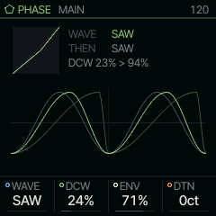
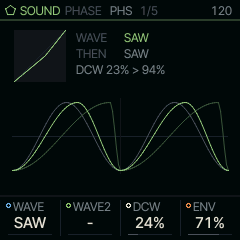
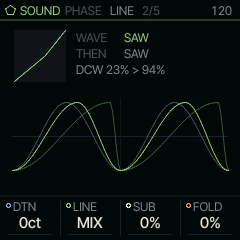

<!-- generated by tools/gen_docs.py from docs/src/sound/phase.md and the firmware: edit the source, not this file -->
# PHASE

PHASE is phase distortion, the method of Casio's CZ synths: a cosine read through a bent phase, so the wave goes
from a sine to a saw, a square or a resonant sweep as the bend grows.

 **SOUND nut:** bends a cosine, CZ style. **Reach it:** white key B4 in the wheel. **ALGORITHM turns:** `WAVE`.

**Engine:** `PHASE`, 6 factory sounds

## Playing it

WAVE on MAIN picks the shape. DCW is the amount of bend (the CZ's "digitally controlled wave"): at 0 every wave is close to a sine, and
turning it up brings in the harmonics. ENV sets how much the envelope opens DCW over each note, DTN detunes a
second line against the first. The release is on ENV.

PHASE is on B4.

## MAIN

| Knob | Label | Range | Starts at |
| --- | --- | --- | --- |
| 1 | `WAVE` | SAW SQR PLS DSIN SPLS RSAW RTRI RTRP | SAW |
| 2 | `DCW` | 0% .. 100% | 24% |
| 3 | `ENV` | 0% .. 100% | 71% |
| 4 | `DTN` | 0ct .. 127ct | 0ct |

## Pages

### PHS

WAVE picks the shape the bend makes. The R waves (RSAW, RTRI, RTRP) are the resonant ones, which sweep like a
filter. WAVE2 alternates with WAVE every other cycle, as on the CZ; "-" turns that off.

| Knob | Label | Range | Starts at |
| --- | --- | --- | --- |
| 1 | `WAVE` | SAW SQR PLS DSIN SPLS RSAW RTRI RTRP | SAW |
| 2 | `WAVE2` | - SAW SQR PLS DSIN SPLS RSAW RTRI RTRP | - |
| 3 | `DCW` | 0% .. 100% | 24% |
| 4 | `ENV` | 0% .. 100% | 71% |

### LINE

DTN and LINE set what the second line does: MIX adds it, RING multiplies the two (ring modulation, for bell and
clangorous tones). SUB adds a sine an octave down. FOLD is a sine wavefolder on the voice: a soft saturation
first, then folds that add harmonics; the high notes fold less, so they stay clean.

| Knob | Label | Range | Starts at |
| --- | --- | --- | --- |
| 1 | `DTN` | 0ct .. 127ct | 0ct |
| 2 | `LINE` | MIX RING | MIX |
| 3 | `SUB` | 0% .. 100% | 0% |
| 4 | `FOLD` | 0% .. 100% | 0% |

### Factory sounds

`BRASS`, `ORGAN`, `STRING`, `RESO`, `BELL`, `WIRE`

## Where it comes from

`firmware/src/eng_phase.c`, Felucca's engine (GPL-3.0), by Leo Kuroshita, Hügelton Instruments; its waveforms
are a port of the oscillator of CrispyZebra, the same author's phase-distortion synth.
