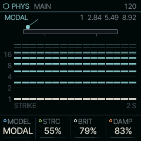
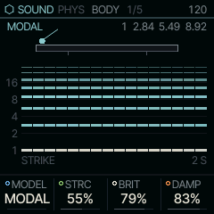
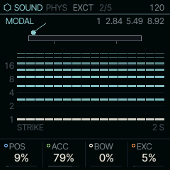

<!-- generated by tools/gen_docs.py from docs/src/sound/phys.md and the firmware: edit the source, not this file -->
# PHYS

PHYS models things that ring when struck, plucked or bowed: bells and bars, strings, drum heads, and a string with
sympathetic strings ringing along.

 **SOUND nut:** rings bars and strings. **Reach it:** white key C5 in the wheel. **ALGORITHM turns:** `MODEL`.

**Engine:** `PHYS`, 9 factory sounds

## Playing it

MAIN starts with MODEL, the kind of body; the other three shape it. STRC is its structure: on a bell or bar it stretches the partials from
harmonic to clangorous, on a string it moves from a buzzy, sitar-like bridge to a stiff, piano-like one. BRIT keeps
the high partials ringing and brightens the strike. DAMP is the decay; at the top the body rings on. POS, on EXCT, is where
it is struck or plucked, which changes which partials sound.

PHYS is not on the default wheel: pick it on the PAIR page (hold HOME, tap GLO, KNOB 1) or give it a key with the
slot picker ([The wheel](../wheel.md)). Its sounds are also in LIBRARY.

## MAIN

| Knob | Label | Range | Starts at |
| --- | --- | --- | --- |
| 1 | `MODEL` | MODAL STRNG MEMB SYMP | MODAL |
| 2 | `STRC` | 0% .. 100% | 55% |
| 3 | `BRIT` | 0% .. 100% | 79% |
| 4 | `DAMP` | 0% .. 100% | 83% |

## Pages

### BODY

MODEL picks what rings. Some knobs take a different name when the model changes; the screen always shows the
current one.

- MODAL: a bank of resonant modes for bells, bars and plates.
- STRNG: a plucked string (an extended Karplus-Strong string, a delay line fed with a burst of noise).
- MEMB: a struck drum head. HARM blends an ideal head (inharmonic, like toms and timpani) into a loaded one with
  harmonic overtones (closer to a tabla), and BEND drops the pitch after the strike.
- SYMP: the plucked string plus three sympathetic strings, as on a sitar. CHRD tunes them to an interval or chord
  above the note, SYMP (in POS's place) sets how much they take from the string, and BUZZ is the curved bridge.

| Knob | Label | Range | Starts at |
| --- | --- | --- | --- |
| 1 | `MODEL` | MODAL STRNG MEMB SYMP | MODAL |
| 2 | `STRC` | 0% .. 100% | 55% |
| 3 | `BRIT` | 0% .. 100% | 79% |
| 4 | `DAMP` | 0% .. 100% | 83% |

### EXCT

EXCT sets how the body is played. ACC is the accent at full velocity: a brighter, longer, louder strike, scaled by
how hard you play. BOW (MODAL and STRNG) sustains the sound with a stream of tiny random hits, so a bell or string
can be bowed or blown instead of struck; MEMB puts BEND on this knob and SYMP puts BUZZ there. EXC mixes in the
exciter itself, the mallet or the pick.

| Knob | Label | Range | Starts at |
| --- | --- | --- | --- |
| 1 | `POS` | 0% .. 100% | 9% |
| 2 | `ACC` | 0% .. 100% | 79% |
| 3 | `BOW` | 0% .. 100% | 0% |
| 4 | `EXC` | 0% .. 100% | 5% |

### Factory sounds

`BELL TREE`, `MARIMBA`, `PLUCK`, `BOWED METAL`, `KALIMBA`, `HAND DRUM`, `TOMS`, `DRONE STRING`, `HARP`

## Where it comes from

`firmware/src/eng_phys.c`, Felucca's engine (GPL-3.0), by Leo Kuroshita, Hügelton Instruments. Its DSP is ported
to fixed point from DaisySP (Electrosmith, Emilie Gillet, MIT) and from Rings' sympathetic strings (Emilie Gillet,
MIT).
