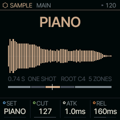
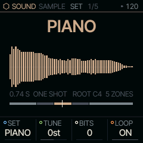
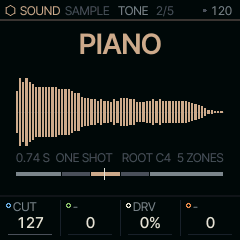

<!-- generated by tools/gen_docs.py from docs/src/sound/sample.md and the firmware: edit the source, not this file -->
# SAMPLE

SAMPLE plays multisampled instruments (piano, flute, saxophone) and up to three samples of your own, spread across
the keyboard.

 **SOUND nut:** plays sampled instruments. **Reach it:** a custom build, FELUCCA_SAMPLE=1 (else on PHYS). **ALGORITHM turns:** `SET`.

**Engine:** `SAMPLE`, 3 factory sounds

## Playing it

SET on MAIN picks the instrument, or one of the user slots USR1 to USR3. CUT darkens it with a low-pass, and ATK
and REL shape the start and end of each note.

The user slots are filled over USB from the editor's Samples tab ([Connections](../connections.md); for developers,
the editor protocol in `web/EDITOR_PROTOCOL.md`). A slot that is empty, or
a set this build left out, plays a plain sine and the screen says NO SAMPLE.

SAMPLE is [on the sidelines](../sidelines.md): SQRL-1's build leaves it out, and its instruments' samples with it.
A custom build with `FELUCCA_SAMPLE=1` brings both back, picked on the PAIR page (hold HOME, tap GLO, KNOB 1).
Without it, a SAMPLE sound in a project or a saved sound plays on PHYS.

## MAIN

| Knob | Label | Range | Starts at |
| --- | --- | --- | --- |
| 1 | `SET` | PIANO FLUTE SAX USR1 USR2 USR3 | PIANO |
| 2 | `CUT` | 0 .. 127 | 127 |
| 3 | `ATK` | 1.0ms .. 10.0s | 1.0ms |
| 4 | `REL` | 1.0ms .. 10.0s | 160ms |

## Pages

### SET

TUNE is in semitones, BITS makes the sound coarser, and LOOP holds a looped note for as long as the key is down.

| Knob | Label | Range | Starts at |
| --- | --- | --- | --- |
| 1 | `SET` | PIANO FLUTE SAX USR1 USR2 USR3 | PIANO |
| 2 | `TUNE` | -24st .. +24st | 0st |
| 3 | `BITS` | 0 .. 127 | 0 |
| 4 | `LOOP` | OFF ON | ON |

### TONE

DRV drives the voice.

| Knob | Label | Range | Starts at |
| --- | --- | --- | --- |
| 1 | `CUT` | 0 .. 127 | 127 |
| 3 | `DRV` | 0% .. 100% | 0% |

### Factory sounds

`PIANO`, `FLUTE`, `SAX`

## Where it comes from

`firmware/src/eng_sample.c`, Felucca's engine (GPL-3.0), by Leo Kuroshita, Hügelton Instruments. The instruments
are from Versilian Studios' VSCO-2 Community Edition and VCSL, CC0 1.0 (`assets/samples-cc0/ATTRIBUTION.txt`),
stored as IMA ADPCM, a compressed audio format that decodes cheaply.
