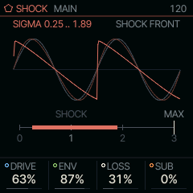
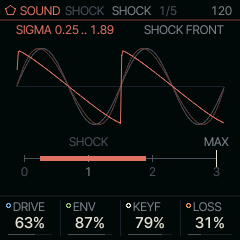
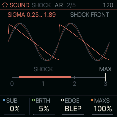

<!-- generated by tools/gen_docs.py from docs/src/sound/shock.md and the firmware: edit the source, not this file -->
# SHOCK

SHOCK bends a sine into a shock wave, the way a loud note steepens as it travels down a brass instrument's bore.
Blow harder (a louder envelope) or play higher and it brightens from a pure tone to a buzzing, brassy saw.

 **SOUND nut:** steepens a sine into brass. **Reach it:** white key E4 in the wheel. **ALGORITHM turns:** `DRIVE`.

**Engine:** `SHOCK`, 8 factory sounds

## Playing it

DRIVE on MAIN sets how far the wave steepens at the top of the envelope: at 0 it stays a sine, around the middle
the shock forms, and past it the wave turns into a sawtooth that decays like brass. ENV sets how much of that the
envelope supplies. At 0 the timbre stays fixed through the note, like a CZ preset; turn it up and each note starts
dark and opens as it swells. LOSS is the bore's damping, a low-pass that follows the note (open at 0). SUB adds a
sine an octave down.

Try a slow attack on the ENV page with ENV high for swelling horns, or ENV at 0 and DRIVE high for a steady,
edgy lead.

SHOCK is on a white key of the wheel ([The wheel](../wheel.md)).

## MAIN

| Knob | Label | Range | Starts at |
| --- | --- | --- | --- |
| 1 | `DRIVE` | 0% .. 100% | 63% |
| 2 | `ENV` | 0% .. 100% | 87% |
| 3 | `LOSS` | 0% .. 100% | 31% |
| 4 | `SUB` | 0% .. 100% | 0% |

## Pages

### SHOCK

KEYF is the key follow. At 0 every note gets the same timbre; turned up, the steepening
grows with pitch, as it does on a real horn. That is the opposite of a CZ synth, whose key follow darkens the high
notes.

| Knob | Label | Range | Starts at |
| --- | --- | --- | --- |
| 1 | `DRIVE` | 0% .. 100% | 63% |
| 2 | `ENV` | 0% .. 100% | 87% |
| 3 | `KEYF` | 0% .. 100% | 79% |
| 4 | `LOSS` | 0% .. 100% | 31% |

### AIR

BRTH blows breath noise through the same bore. EDGE RAW leaves the shock's step
unfiltered, which aliases (folds high harmonics back down as harsh tones); BLEP smooths it. MAXS is the ceiling on
how far DRIVE can push the wave.

| Knob | Label | Range | Starts at |
| --- | --- | --- | --- |
| 1 | `SUB` | 0% .. 100% | 0% |
| 2 | `BRTH` | 0% .. 100% | 5% |
| 3 | `EDGE` | RAW BLEP | BLEP |
| 4 | `MAXS` | 0% .. 100% | 100% |

### Factory sounds

`BRASS`, `CZ SAW`, `BLOOM`, `SHOCK BASS`, `HORN SECTION`, `TUBA`, `BREATH`, `RAW SHOCK`

## Where it comes from

The wave is Earnshaw's simple wave, which has the same form as Kepler's equation: the sample read at phase θ is
sin(φ) with θ = φ − σ sin(φ), where σ is the distance travelled in shock-formation lengths. SHOCK reads it from a
precomputed table instead of solving it per sample. `firmware/src/eng_shock.c`, `shock.c` and `shock.h`, from
databurn (MIT).
