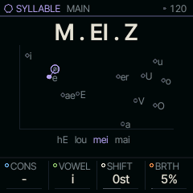
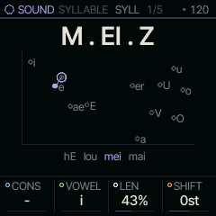
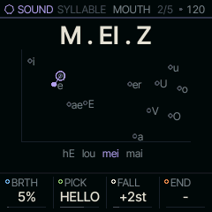

<!-- generated by tools/gen_docs.py from docs/src/sound/syllable.md and the firmware: edit the source, not this file -->
# SYLLABLE

SYLLABLE sings syllables: each key plays a consonant into a vowel, and the vowel holds for as long as the key does.
It is a formant synthesizer in the style of Klatt's, built for the consonants that
[VOICE](voice.md) does not have.

 **SOUND nut:** sings syllables. **Reach it:** a custom build, FELUCCA_SYLLABLE=1 (else on MOUTH). **ALGORITHM turns:** `CONS`.

**Engine:** `SYLLABLE`, 11 factory sounds

## Playing it

Every note sings CONS into VOWEL on the key's pitch, up to four at once. Hold the key and the vowel sustains; let
go and the syllable ends, closed by END if you have set one (ba with END on t sings "bat").

ALGORITHM picks the consonant. MAIN's four knobs build the syllable:

- CONS picks the consonant: stops such as b, d and k, nasals such as m and n, hissing s, z and sh, and more. The
  dash means none, a bare vowel.
- VOWEL picks one of Hillenbrand's twelve vowels, a diphthong (a vowel that glides into another), or iau, a cat's
  "mee-ow" when it follows m.
- SHIFT moves every formant (the resonances of the mouth) up or down: up for a smaller mouth, down for a larger one.
- BRTH adds breath noise under the whole syllable.

The screen spells the syllable over a vowel chart: the twelve vowels sit where their first two formants put them,
the sung vowel is a dot, and a diphthong is an arrow from its first vowel to its second.

Load HELLO and play four notes in a row: its PICK is set to the HELLO phrase, so it sings one syllable per note.

SYLLABLE is [on the sidelines](../sidelines.md): SQRL-1's build leaves it out. A custom build with
`FELUCCA_SYLLABLE=1` brings it back, picked on the PAIR page (hold HOME, tap GLO, KNOB 1). Without it, a SYLLABLE
sound in a project or a saved sound plays on MOUTH.

## MAIN

| Knob | Label | Range | Starts at |
| --- | --- | --- | --- |
| 1 | `CONS` | 19 values: - b d g .. y | b |
| 2 | `VOWEL` | 18 values: i I e E .. iau | a |
| 3 | `SHIFT` | -12st .. +12st | 0st |
| 4 | `BRTH` | 0% .. 100% | 0% |

## Pages

### SYLL

LEN shortens or stretches the consonant before the vowel arrives.

| Knob | Label | Range | Starts at |
| --- | --- | --- | --- |
| 1 | `CONS` | 19 values: - b d g .. y | b |
| 2 | `VOWEL` | 18 values: i I e E .. iau | a |
| 3 | `LEN` | 0% .. 100% | 50% |
| 4 | `SHIFT` | -12st .. +12st | 0st |

### MOUTH

PICK decides what the next note sings. FIX sings the syllable as set. C>> steps to the next consonant with each note,
V>> to the next vowel, BOTH to both, and RAND picks at random. The named settings are phrases, sung a syllable at a
time: HELLO sings "hel-lo maze-mind", DATABN "da-ta-burn", FM ONE "ef-em-one" and ROBOT "ro-bot".
A take sings its phrase from the top each pass: on a part that holds a take or is recording one, the phrases, C>>
and V>> start over at step 1, so the loop sings what you sang.

FALL lets the pitch drop over each syllable, as speech does at the end of a phrase. END is the consonant that closes
the syllable when the key is let go. It plays during the release, so give the sound a release long enough to hear it
(ENV, REL).

| Knob | Label | Range | Starts at |
| --- | --- | --- | --- |
| 1 | `BRTH` | 0% .. 100% | 0% |
| 2 | `PICK` | FIX C>> V>> BOTH RAND HELLO DATABN FM ONE ROBOT | C>> |
| 3 | `FALL` | 0st .. +12st | +2st |
| 4 | `END` | 19 values: - b d g .. y | - |

### Factory sounds

`CYCLE`, `BAT BIT BUT`, `MAMA`, `SING SONG`, `SHUSH`, `BABBLE`, `LALA CHOIR`, `SMALL MOUTH`, `HELLO`, `DATA BURN`, `NIBS`

## Where it comes from

The synthesizer follows Klatt (1980): a cascade of formant filters for the vowels and parallel ones for the
consonants. The vowels' formants come from Hillenbrand et al. (1995). The C code, `firmware/src/syllable.c` and
`firmware/src/eng_syllable.c` (MIT), was checked bit for bit against a reference model that is not published.
