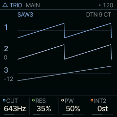
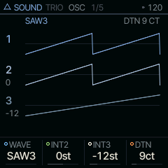
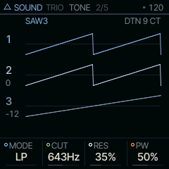

<!-- generated by tools/gen_docs.py from docs/src/sound/trio.md and the firmware: edit the source, not this file -->
# TRIO

TRIO is three oscillators with ring modulation and hard sync (one oscillator restarting another every cycle) into
a low-pass, band-pass, high-pass or notch filter, after the sound chips in early 8-bit home computers.

 **SOUND nut:** stacks three oscillators. **Reach it:** a custom build, FELUCCA_TRIO=1 (else on ANALOG). **ALGORITHM turns:** `WAVE`.

**Engine:** `TRIO`, 5 factory sounds

## Playing it

MAIN holds the filter's CUT and RES, PW (the pulse width, for the waves that use a pulse), and INT2, the
interval of the second oscillator in semitones. Set INT2 to 7 or 12 for fifths or octaves stacked in one note.

WAVE, on the OSC page, is the big choice: each setting is a whole set of three waves, their levels and how they
interact.

TRIO is [on the sidelines](../sidelines.md): SQRL-1's build leaves it out. A custom build with `FELUCCA_TRIO=1` brings
it back, picked on the PAIR page (hold HOME, tap GLO, KNOB 1). Without it, a TRIO sound in a project or a saved sound
plays on ANALOG.

## MAIN

| Knob | Label | Range | Starts at |
| --- | --- | --- | --- |
| 1 | `CUT` | 30Hz .. 16.0kHz | 643Hz |
| 2 | `RES` | 0% .. 100% | 35% |
| 3 | `PW` | 0% .. 100% | 50% |
| 4 | `INT2` | -24st .. +24st | 0st |

## Pages

### OSC

WAVE picks the set. Some stack three of one wave (SAW3, PLS3, TRI3); some combine two waves the way those chips
did, with a bitwise AND (S&T, P&S); the SYNC settings restart oscillator 2 at every cycle of oscillator 1; the
RING settings flip oscillator 1's sign with oscillator 3 for a metallic ring. INT2 and INT3 tune oscillators 2
and 3 against the note, and DTN spreads them apart in cents (2 up, 3 down).

| Knob | Label | Range | Starts at |
| --- | --- | --- | --- |
| 1 | `WAVE` | 16 values: SAW3 PLS3 PPT SST .. R+SP | SAW3 |
| 2 | `INT2` | -24st .. +24st | 0st |
| 3 | `INT3` | -24st .. +24st | -12st |
| 4 | `DTN` | 0ct .. 50ct | 9ct |

### TONE

MODE picks low-pass, band-pass, high-pass or notch. The resonance stops short of self-oscillation and gets gritty
instead of ringing when pushed, and the cutoff drifts slowly, like an old chip's.

| Knob | Label | Range | Starts at |
| --- | --- | --- | --- |
| 1 | `MODE` | LP BP HP NOT | LP |
| 2 | `CUT` | 30Hz .. 16.0kHz | 643Hz |
| 3 | `RES` | 0% .. 100% | 35% |
| 4 | `PW` | 0% .. 100% | 50% |

### Factory sounds

`FAT BASS`, `ARP LEAD`, `SYNC LEAD`, `RING BELL`, `CHIP CHOIR`

## Where it comes from

`firmware/src/eng_trio.c`, Felucca's own design (GPL-3.0), by Leo Kuroshita, Hügelton Instruments.
