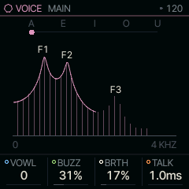
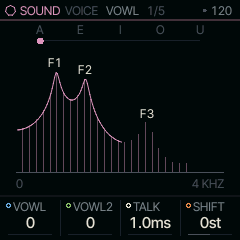
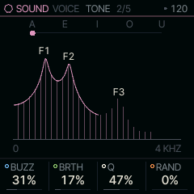

<!-- generated by tools/gen_docs.py from docs/src/sound/voice.md and the firmware: edit the source, not this file -->
# VOICE

VOICE sings vowels from the keyboard: a glottal pulse (the buzz of the vocal folds) through four formant
filters, the resonances that make an "ah" different from an "oo".

 **SOUND nut:** sings vowels. **Reach it:** a custom build, FELUCCA_VOICE=1 (else on MOUTH). **ALGORITHM turns:** `VOWL`.

**Engine:** `VOICE`, 4 factory sounds

## Playing it

VOWL on MAIN moves through the vowels A, E, I, O and U, blending between neighbours. BUZZ sets how bright and
pressed the voice is, from a soft, open tone to a buzzy one. BRTH mixes in breath noise; at the top the voicing
fades out and the voice whispers. TALK is a glide time: each note moves from VOWL to a second vowel, VOWL2, over
that time, so a held chord can say "ah-oo".

VOICE is [on the sidelines](../sidelines.md): SQRL-1's build leaves it out. A custom build with `FELUCCA_VOICE=1`
brings it back, picked on the PAIR page (hold HOME, tap GLO, KNOB 1). Without it, a VOICE sound in a project or a
saved sound plays on MOUTH.

## MAIN

| Knob | Label | Range | Starts at |
| --- | --- | --- | --- |
| 1 | `VOWL` | 0 .. 127 | 0 |
| 2 | `BUZZ` | 0% .. 100% | 31% |
| 3 | `BRTH` | 0% .. 100% | 17% |
| 4 | `TALK` | 1.0ms .. 10.0s | 1.0ms |

## Pages

### VOWL

SHIFT moves the formants up or down in semitones: down for a bigger, darker throat, up for a smaller one.

| Knob | Label | Range | Starts at |
| --- | --- | --- | --- |
| 1 | `VOWL` | 0 .. 127 | 0 |
| 2 | `VOWL2` | 0 .. 127 | 0 |
| 3 | `TALK` | 1.0ms .. 10.0s | 1.0ms |
| 4 | `SHIFT` | -12st .. +12st | 0st |

### TONE

Q sets how narrow the formants are: high values ring, low ones blur. RAND pulls both vowels towards a random vowel
chosen for each note, so a choir's voices do not all say the same thing.

| Knob | Label | Range | Starts at |
| --- | --- | --- | --- |
| 1 | `BUZZ` | 0% .. 100% | 31% |
| 2 | `BRTH` | 0% .. 100% | 17% |
| 3 | `Q` | 0% .. 100% | 47% |
| 4 | `RAND` | 0% .. 100% | 0% |

### Factory sounds

`CHOIR AAH`, `VOX LEAD`, `WOW BASS`, `WHISPER`

## Where it comes from

`firmware/src/eng_formant.c`, Felucca's engine (GPL-3.0), by Leo Kuroshita, Hügelton Instruments. It follows
D. H. Klatt's cascade formant synthesizer (JASA, 1980), with a Rosenberg glottal pulse and vowel formants from
Hillenbrand et al. (JASA, 1995).
