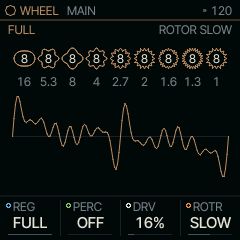
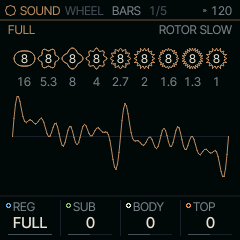
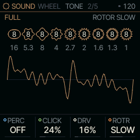

<!-- generated by tools/gen_docs.py from docs/src/sound/wheel.md and the firmware: edit the source, not this file -->
# WHEEL

WHEEL is Felucca's tonewheel organ: pick a drawbar registration from a list, shade it with three knobs, and add
percussion, key click, drive and a rotary speaker.

 **SOUND nut:** plays Felucca's organ. **Reach it:** a custom build, FELUCCA_WHEEL=1 (else on ANALOG). **ALGORITHM turns:** `REG`.

**Engine:** `WHEEL`, 5 factory sounds

## Playing it

REG on MAIN picks a registration, a preset setting of all nine drawbars (FLUTE, GOSPL, ROCK, FULL and others).
PERC adds the struck 2nd or 3rd harmonic, normal, soft or slow; it is single trigger, so only a note started with
no other key held gets it. DRV is a soft overdrive on each voice. ROTR spins a rotary speaker SLOW or FAST, and the
rotors ramp between the speeds rather than jump.

WHEEL is [on the sidelines](../sidelines.md): SQRL-1's build leaves it out. A custom build with `FELUCCA_WHEEL=1`
brings it back, picked on the PAIR page (hold HOME, tap GLO, KNOB 1). Without it, a WHEEL sound in a project or a
saved sound plays on ANALOG.

## MAIN

| Knob | Label | Range | Starts at |
| --- | --- | --- | --- |
| 1 | `REG` | 16 values: FLUTE MELLO HOLLW SMOOT .. FULL | FULL |
| 2 | `PERC` | OFF 2ND 3RD 2SOFT 3SOFT 2SLOW 3SLOW | OFF |
| 3 | `DRV` | 0% .. 100% | 16% |
| 4 | `ROTR` | OFF SLOW FAST | SLOW |

## Pages

### BARS

SUB, BODY and TOP raise or lower groups of the registration's bars: SUB the 16' and
5-1/3', BODY the 8' and 4', TOP everything from 2-2/3' up. Louder registrations give each bar a little less, so a
full organ is louder than one bar without clipping.

| Knob | Label | Range | Starts at |
| --- | --- | --- | --- |
| 1 | `REG` | 16 values: FLUTE MELLO HOLLW SMOOT .. FULL | FULL |
| 2 | `SUB` | -8 .. 8 | 0 |
| 3 | `BODY` | -8 .. 8 | 0 |
| 4 | `TOP` | -8 .. 8 | 0 |

### TONE

CLICK is the burst of noise at the key contact. With PERC on, the 1' bar falls silent and, at
normal level, the other bars drop about 3 dB, as on the original circuit.

| Knob | Label | Range | Starts at |
| --- | --- | --- | --- |
| 1 | `PERC` | OFF 2ND 3RD 2SOFT 3SOFT 2SLOW 3SLOW | OFF |
| 2 | `CLICK` | 0% .. 100% | 24% |
| 3 | `DRV` | 0% .. 100% | 16% |
| 4 | `ROTR` | OFF SLOW FAST | SLOW |

### Factory sounds

`FULL ORGAN`, `JAZZ PERC`, `GOSPEL`, `SOFT FLUTE`, `ROCK DRIVE`

## WHEEL and ORGAN

Both are tonewheel organs. WHEEL works from a list of registrations with three shading knobs and has its own drive
and rotor; it plays nine sines per voice. ORGAN sets each drawbar directly (the top three as one) and reads one
wavetable a voice; it has no rotor, so it pairs with the ROTOR insert.

## Where it comes from

`firmware/src/eng_wheel.c`, Felucca's own design (GPL-3.0), by Leo Kuroshita, Hügelton Instruments.
