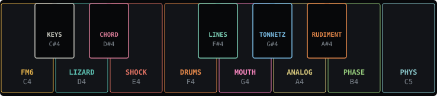
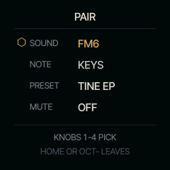

<!-- generated by tools/gen_docs.py from docs/src/wheel.md and the firmware: edit the source, not this file -->
# The wheel

You always play a pair: one SOUND and one NOTE engine. The wheel is where you choose both, on the octave of keys
from C4 to C5. Each white key holds one of the eight SOUNDs and each black key a NOTE engine, and you decide which
NOTE engine sits on which black key.

## Choosing a pair

Hold **HOME** and the wheel opens. Press a white key to pick the SOUND and a black key to pick the NOTE engine, in
either order, then let go of HOME. The pair starts at once, and the previous one releases its notes with their own
tails. While HOME is held, the keys that hold a SOUND or a NOTE engine light up, the selected two brightest.

SELECT and PRESETS move the cursor from SOUND to SOUND. One step past C5, or before C4, it lands in the middle,
which says SYSTEM: let go of HOME there to open SYSTEM. Only the black keys choose the NOTE engine.

*The wheel, HOME held: FM6 with KEYS selected.*

Press **OCT-** while the wheel is open to close it and stay where you were. Tap HOME twice quickly, outside the
wheel, to go to the pair playing behind, or with none, back to the pair you played before. Double tap again for the
next pair playing, and on round them all.

## Ways to switch

| You want | Do |
| --- | --- |
| a pair you have on the wheel | hold HOME, press its keys, let go |
| only the SOUND or only the NOTE | hold GLO, press its key |
| to browse everything by eye | hold HOME, tap GLO: the PAIR page |
| the pair you played before, or each pair playing behind in turn | tap HOME twice, and again |

## The pair by knobs

Hold **HOME**, tap **GLO** and let go: the PAIR page stays open, and the four knobs choose the pair. KNOB 1 and 2
pick the SOUND and the NOTE engine as you scroll, and the pair goes to the front when you leave the page, so
scrolling past a NOTE engine leaves nothing playing behind. PRESET and MUTE put the pair you picked in front first.

*The PAIR page: FM6 with KEYS, its preset, and MUTE.*

| Knob | Chooses |
| --- | --- |
| 1 SOUND | the SOUND (SELECT too), in front on leaving |
| 2 NOTE | the NOTE engine, in front on leaving |
| 3 PRESET | the SOUND's sound (PRESETS too) |
| 4 MUTE | right: the pair's part muted; left: back |

Tap **HOME** or **OCT-** to leave on the pair you chose. The wheel's keys stay as they were. While the wheel is
open, its bottom line takes turns every two seconds with two reminders: TAP GLO: PICK BY KNOBS (PAIR PAGE), and
HOLD GLO + A BLACK KEY: CHANGE IT (the slot picker, below).

Without opening the wheel, hold **GLO** and press a white key between C4 and C5 to change the SOUND and keep the
NOTE engine, or a black key to change the NOTE engine and keep the SOUND.

Each nut remembers where you left it. A SOUND keeps its sound and its pages for as long as the FM-1 is on, and a
NOTE engine keeps its settings.

## The slot picker

The white keys are fixed: FM6, LIZARD, SHOCK, DRUMS, MOUTH, ANALOG, PHASE and PHYS. The black keys are yours. With
the wheel open, hold **GLO** and press a black key: every NOTE engine is listed. Turn **SELECT** or PRESETS to choose
and let go of GLO to put it on the key, then let go of HOME. Keep HOME held until GLO is up: letting go of HOME
first, or pressing OCT-, leaves the key as it was.

A NOTE engine already on another black key is skipped, so each appears once. It starts with its arpeggiator and
pattern fresh, and its own four knobs keep what you set. The black keys are saved and come back after power-off;
**Restore default layout** on the installer page (below) brings the starting ones back.

The installer page can set the black keys at once: open **Set up your wheel**, read it from the FM-1, choose a NOTE
engine for each black key and save. It follows the same rules. A layout from an older installer that names white
keys too sets the black keys and leaves the white ones as they are.

## Tracks: BEAT, LINE and PLAY

SQRL-1 has three tracks. BEAT is RUDIMENT, on part 4. LINE is the NOTE engine that plays by itself: LINES, ALIVE,
TONNETZ, ENIGMA, S+H, CANON or ACID, one at a time, on part 3. PLAY is what you play from the keys (KEYS, CHORD, HARP), on parts 1 and
2 in turn, with your takes.

Nothing stops because you left it. BEAT and LINE, once they have something to play, run whenever the transport runs.
A generator on LINE (ALIVE, TONNETZ, ENIGMA, S+H, CANON) stays there only once you used it: played a key, turned a
knob or ALGORITHM, or pressed PLAY while it was in front. One you only visited gives LINE back, as you leave it, to
what LINE had before, so looking at a generator never leaves it playing behind everything.
A PLAY pair with a take loops on too when you leave it, on its part, so you can keep a loop of the keys or a chord
running while you build the drums. Choosing another LINE engine replaces what LINE plays, as choosing another SOUND
for RUDIMENT replaces BEAT's sound.

To see what plays, hold HOME. The keys of every pair playing on a part flip on its beat: the pair picked goes dark
for a moment, the others light up. A muted pair's keys breathe. On the screen a pair that plays has a small green play
mark by its SOUND and a dot by its NOTE engine; a muted one has a dim pause mark and a dim dot. With the transport
running, the wheel opens with a line naming what plays behind the pair in front (`FM6 KEYS + DRUMS RUDIMENT`, or only the
NOTE engines when that is too long).

PLAY has two parts, so two takes can loop together. A new PLAY pair goes to a part with nothing on it, or an empty
pattern, first; then to a muted one; then to the one you left longest ago. The take there stops, and the toast says
so (`FM6 KEYS STOPS: PART 2`), but it is not lost: it stays with its pair and comes back when you pick that pair
again. Going back to a pair still looping brings it to the front as it plays, in time. REC arms only the pair in
front: a take looping on never records. A note you play in front is never cut to make room for a take looping on,
unless the front holds all eight voices itself.

To silence a part, hold HOME, press its pair's keys and, with HOME still held, press **PLAY**: it is muted, and HOME
glows while any part is. Do it again to bring it back. A PLAY pair that no part holds says NOTHING TO MUTE. **PLAY** on
the wheel's centre (SYSTEM) stops everything.

To clear a pair without hunting for it, hold HOME, press its keys and hold **REC**: the pair comes to the front and
REC's rings run over it, the first undoing its last take, the second clearing it. Let go early and it is only in
front, not armed.

LINE's generators are its content: what ALIVE, TONNETZ, ENIGMA, S+H and CANON play is never recorded into their part, and they
never fall silent for a take. Record over them on PLAY.
